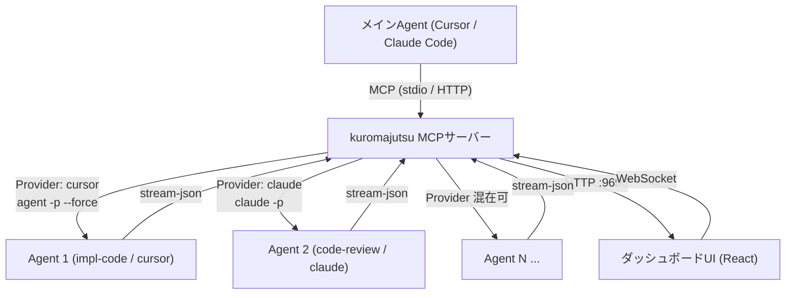
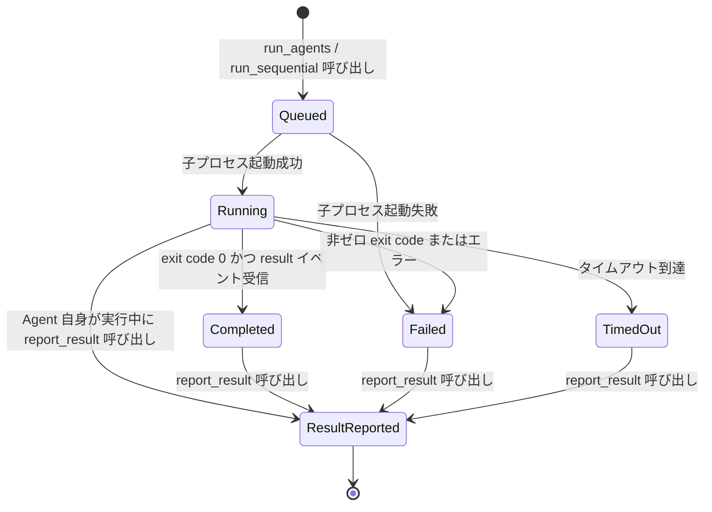
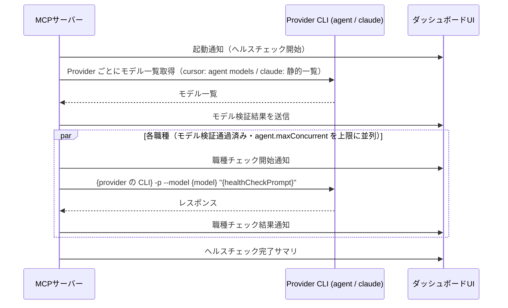
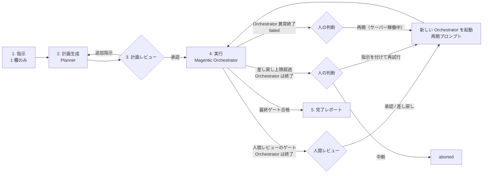
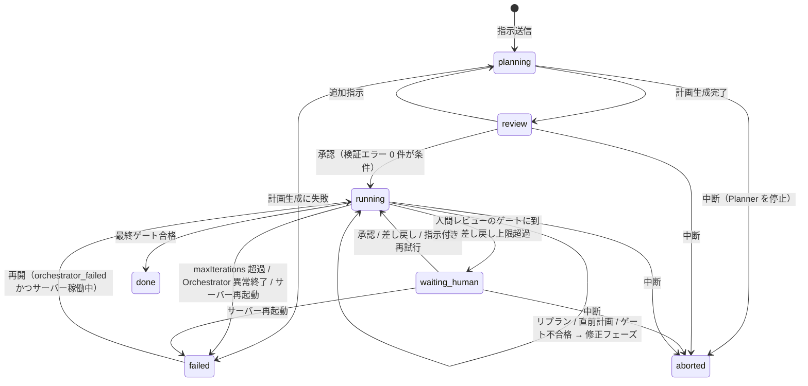
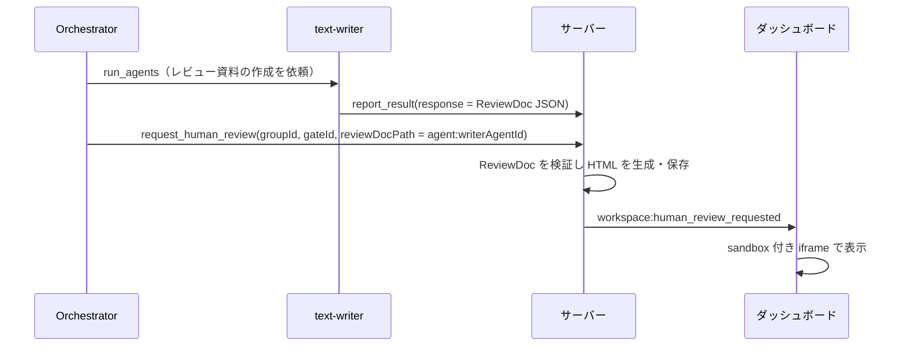
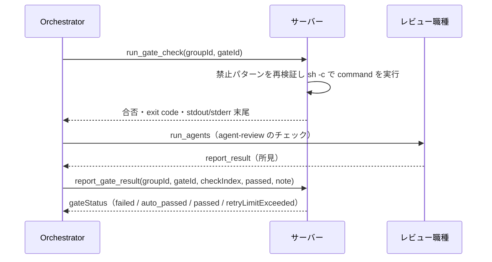
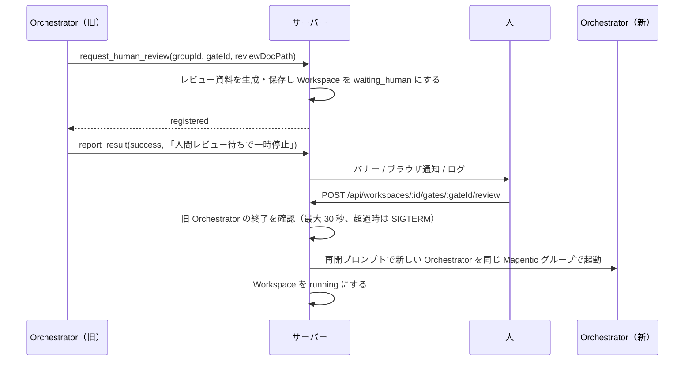

# Kuromajutsu 仕様書

> Cursor / Claude マルチ Provider Agent 並列実行管理システム

## 1. システム概要

### 1.1 目的

Kuromajutsu は、MCP（Model Context Protocol）サーバーとして動作し、メイン Agent（Cursor / Claude Code など）から複数のサブ Agent を並列に起動・管理するためのシステムである。サブ Agent の実行基盤（**Provider**）として Cursor CLI と Claude Code CLI の両方に対応し、職種ごとに Provider とモデルを指定することで、複数 Provider のモデルを混在させて並列実行できる。各 Agent は「職種（Role）」として定義された役割に基づいて動作し、コード実装、レビュー、テスト作成などのタスクを並行して処理できる。

Agent の実行は必ず「グループ（Group）」に所属させる。グループは関連するタスク群をまとめる単位であり、MCP ツール経由で事前に作成する。グループには目的の簡潔な説明を登録し、一意の ID が発番される。これにより、ダッシュボード UI 上で Agent をグループ単位で整理・表示でき、タスクの見通しが向上する。

さらに、指示から作業計画（フェーズ・手順・ゲート）を作り、人が承認してから Magentic Orchestrator で実行する **Workspace（作業スペース）** 機能を提供する（§13）。

### 1.2 全体アーキテクチャ



### 1.3 技術スタック

| コンポーネント | 技術 |
|---|---|
| MCPサーバー | TypeScript + Node.js（`@modelcontextprotocol/sdk`、stdio トランスポート） |
| ダッシュボードUI | React（MCPサーバーが内蔵HTTPサーバーでホスティング） |
| リアルタイム通信 | WebSocket（UI ⇔ MCPサーバー間） |
| Agent実行 | Provider 抽象化（Cursor CLI `agent` / Claude Code CLI `claude` のヘッドレスモード） |
| 設定管理 | YAML（`kuromajutsu.config.yaml`） |
| コンテナ実行環境 | Docker / Docker Compose |

### 1.3.1 実行環境

テスト・ビルドは Docker コンテナ内で実行する。開発実行（`npm run dev`）は Cursor CLI（`agent` コマンド）および Claude Code CLI（`claude` コマンド）を必要とするため、ホスト上で直接実行する。

**開発実行（ホスト）:**

```bash
# セットアップ（初回のみ）
npm install

# 開発モード（ホットリロード付き、Cursor CLI / Claude Code CLI 利用可能）
npm run dev
```

**テスト・ビルド（Docker）:**

```bash
# ビルド
docker compose run --rm app npm run build

# テスト
docker compose run --rm app npm test
```

**ダッシュボード確認のみ（Docker）:**

```bash
# Docker でダッシュボードを起動（Cursor CLI / Claude Code CLI 機能は動作しない）
docker compose up
```

**ポートマッピング:**
- `9696:9696` — ダッシュボード UI

**ボリューム:**
- プロジェクトルートをコンテナにマウント（ホットリロード対応）
- `node_modules` はコンテナ内に隔離（ホスト側の `node_modules` とは独立）

### 1.4 動作原理

1. メイン Agent が MCP ツール `create_group` でグループを作成する
2. メイン Agent が `run_agents`（または `run_sequential`）にグループ ID を指定して Agent を起動する
3. MCPサーバーが職種の `provider` に対応する CLI（Cursor: `agent -p --force` / Claude: `claude -p`）をヘッドレスモードで子プロセスとして起動する
4. 子プロセスの `stream-json` 出力を Provider ごとのノーマライザで共通イベント形式に変換し、リアルタイムにパースして進捗を追跡する
5. メイン Agent は `wait_agent` で完了を待機し、`report_result` で結果を収集する
6. 用が済んだら `delete_group` でグループを削除する
7. ダッシュボード UI は WebSocket 経由でリアルタイムにすべての Agent の状態をグループ単位で表示する

---

## 2. MCPサーバー

### 2.1 トランスポート

- Cursor との通信: **stdio**（標準入出力）
- ダッシュボード UI 配信: **HTTP**（ポート `9696`「くろくろ」）
- UI リアルタイム更新: **WebSocket**（同ポート）

### 2.2 提供ツール一覧

MCPサーバーは以下の **14個のツール** を提供する。

| ツール名 | 説明 |
|---|---|
| `create_group` | グループを作成する |
| `delete_group` | グループを削除する |
| `run_agents` | 1台以上の Agent を一括起動する（Concurrent グループ用） |
| `run_sequential` | ステージ制 Sequential 実行計画を投入する |
| `run_magentic` | Magentic パターン（Orchestrator 自律管理）でタスクを実行する |
| `list_agents` | 実行中の Agent 一覧を取得する |
| `get_agent_status` | Agent の詳細状況を取得する |
| `wait_agent` | Agent の完了を待機する |
| `report_result` | Agent の実行結果を登録する |
| `list_roles` | 利用可能な職種一覧を返す |
| `update_ledger` | Magentic モードの台帳（Ledger）を更新する |
| `run_gate_check` | Workspace のゲートの `command` チェックをサーバーが実行する（Workspace の Orchestrator 用） |
| `report_gate_result` | Workspace のゲートの `agent-review` チェックの結果を記録する（Workspace の Orchestrator 用） |
| `request_human_review` | Workspace のゲートの人間レビューを依頼する（Workspace の Orchestrator 用） |

#### 2.2.1 `create_group` — グループを作成する

関連する Agent 群をまとめるグループを作成し、一意の ID を発番して返す。Agent を実行する前に、必ずグループを作成する必要がある。

**入力パラメータ:**

| パラメータ | 型 | 必須 | 説明 |
|---|---|---|---|
| `description` | `string` | はい | グループの目的の簡潔な説明（例: 「認証機能の実装・テスト・レビュー」） |
| `mode` | `string` | いいえ | 実行モード: `concurrent`（デフォルト）または `sequential` |
| `parentGroupId` | `string` | いいえ | 親グループ ID（Magentic モードの子グループ作成時に指定） |

**返却値:**

```json
{
  "groupId": "grp-1739487600-b4e1",
  "description": "認証機能の実装・テスト・レビュー",
  "mode": "concurrent",
  "createdAt": "2026-02-13T12:00:00.000Z",
  "status": "active"
}
```

**内部動作:**
1. ID を `grp-{unixTimestamp}-{random4hex}` 形式で発番する
2. `mode` を指定に従って設定する（未指定時は `concurrent`）
3. グループを管理テーブル（インメモリ Map）に登録する
4. WebSocket 経由でダッシュボード UI に通知する

#### 2.2.2 `delete_group` — グループを削除する

指定したグループを削除する。グループに所属する Agent がすべて完了済み（または未登録）であることが条件。実行中の Agent が存在する場合はエラーを返す。

**入力パラメータ:**

| パラメータ | 型 | 必須 | 説明 |
|---|---|---|---|
| `groupId` | `string` | はい | 削除対象のグループ ID |

**返却値:**

```json
{
  "deleted": true,
  "groupId": "grp-1739487600-b4e1"
}
```

**内部動作:**
1. グループの存在を検証する
2. グループに所属する実行中の Agent がないことを確認する（実行中の Agent がある場合はエラー）
3. グループのステータスを `"deleted"` に変更する
4. 完了済み Agent は履歴として保持する（削除しない）
5. 削除済みグループの Agent が全体で最大 20 件を超えた場合、古い Agent から自動的に削除する（Agent がなくなったグループは管理テーブルから除去する）
6. WebSocket 経由でダッシュボード UI に通知する

#### 2.2.3 `run_agents` — Agent を一括起動する

指定した職種とプロンプトで 1 台以上の Agent を一括起動する（Concurrent グループ用）。各 Agent は必ずグループに所属させる。

**入力パラメータ:**

| パラメータ | 型 | 必須 | 説明 |
|---|---|---|---|
| `groupId` | `string` | はい | 所属するグループ ID |
| `agents` | `array` | はい | 起動する Agent の定義配列。各要素: `{ role: string, prompt: string, workingDirectory?: string, timeout_ms?: number }` |

**モデルの決定:** `run_agents` はモデルパラメータを受け付けない。使用するモデルは職種（Role）の設定に従う。

**返却値:**

```json
{
  "agents": [
    {
      "agentId": "impl-code-1739487600-a3f2",
      "groupId": "grp-1739487600-b4e1",
      "role": "impl-code",
      "model": "claude-4-sonnet",
      "provider": "claude",
      "status": "queued"
    }
  ],
  "total": 1
}
```

**エラーコード:** `GROUP_NOT_FOUND`, `GROUP_NOT_ACTIVE`, `MODE_MISMATCH`, `ROLE_NOT_FOUND`, `ROLE_UNAVAILABLE`, `MAX_CONCURRENT_REACHED`, `AGENTS_START_FAILED`, `EMPTY_AGENTS`

**内部動作:**
1. 指定された `groupId` が存在し、アクティブかつ `mode: "concurrent"` であることを検証する
2. 各 Agent の `role` が存在し、利用可能（ヘルスチェック通過済み）か検証する
3. 各 Agent に ID を `{role}-{timestamp}-{random4}` 形式で発番する
4. Agent をグループに紐付けて管理テーブルに登録する
5. 各 Agent の職種に設定された Provider の CLI（Cursor / Claude Code）を Agent ごとに起動する
6. 子プロセスの stream-json 出力をリアルタイムでパースし、内部状態を更新する
7. WebSocket 経由でダッシュボード UI に通知する

#### 2.2.4 `run_sequential` — Sequential 実行計画を投入する

ステージ制の Sequential 実行計画を投入する。各ステージ内は並列実行、ステージ間は直列に実行される。

**入力パラメータ:**

| パラメータ | 型 | 必須 | 説明 |
|---|---|---|---|
| `groupId` | `string` | はい | 所属するグループ ID（`mode: "sequential"` で作成済み） |
| `stages` | `array` | はい | 実行ステージの配列。各要素: `{ tasks: [{ role, prompt, workingDirectory?, timeout_ms? }] }` |

**返却値:**

```json
{
  "groupId": "grp-1739487600-b4e1",
  "totalStages": 3,
  "currentStageIndex": 0,
  "stages": [...],
  "agents": [...],
  "total": 1
}
```

**前ステージ結果の自動注入:** Stage N（N > 0）の Agent 起動時、直前ステージの全 Agent の `summary` + `response` をプロンプトに自動注入する。

**エラーコード:** `GROUP_NOT_FOUND`, `GROUP_NOT_ACTIVE`, `MODE_MISMATCH`, `ROLE_NOT_FOUND`, `ROLE_UNAVAILABLE`, `MAX_CONCURRENT_REACHED`, `EMPTY_STAGES`, `EMPTY_STAGE_TASKS`, `SEQUENTIAL_START_FAILED`

#### 2.2.5 `list_agents` — 実行中の Agent 一覧を取得する

現在管理しているすべての Agent（実行中・完了済み含む）の一覧を返す。グループ ID を指定して、特定グループに所属する Agent のみをフィルタリングできる。

**入力パラメータ:**

| パラメータ | 型 | 必須 | 説明 |
|---|---|---|---|
| `groupId` | `string` | いいえ | フィルタ: 指定したグループに所属する Agent のみ取得 |
| `status` | `string` | いいえ | フィルタ: `running`, `completed`, `failed`, `all`（デフォルト: `all`） |

**返却値:**

```json
{
  "agents": [
    {
      "agentId": "impl-code-1739487600-a3f2",
      "groupId": "grp-1739487600-b4e1",
      "role": "impl-code",
      "model": "claude-4-sonnet",
      "provider": "claude",
      "status": "running",
      "startedAt": "2026-02-13T12:00:00.000Z",
      "elapsed_ms": 15000,
      "toolCallCount": 3
    }
  ],
  "total": 1
}
```

#### 2.2.6 `get_agent_status` — Agent の詳細状況を取得する

指定した ID の Agent のリアルタイム詳細情報を返す。

**入力パラメータ:**

| パラメータ | 型 | 必須 | 説明 |
|---|---|---|---|
| `agentId` | `string` | はい | Agent ID |

**返却値:**

```json
{
  "agentId": "impl-code-1739487600-a3f2",
  "groupId": "grp-1739487600-b4e1",
  "role": "impl-code",
  "model": "claude-4-sonnet",
  "provider": "claude",
  "status": "running",
  "startedAt": "2026-02-13T12:00:00.000Z",
  "elapsed_ms": 15000,
  "toolCallCount": 5,
  "result": null
}
```

> **設計意図:** メイン Agent のコンテキストを圧迫しないよう、`recentToolCalls`・`lastAssistantMessage`・`editedFiles`・`createdFiles` は返却しない。これらはダッシュボード UI（WebSocket 経由）で別途確認可能。完了済み Agent の場合は `result` フィールドに `summary`・`response`・`editedFiles`・`createdFiles` 等が含まれる。

#### 2.2.7 `wait_agent` — Agent の完了を待機する

指定した Agent（複数可）が完了するまでブロックする。

**入力パラメータ:**

| パラメータ | 型 | 必須 | 説明 |
|---|---|---|---|
| `agentIds` | `string[]` | はい | 待機対象の Agent ID の配列 |
| `timeout_ms` | `number` | いいえ | 全体のタイムアウト（ミリ秒）。デフォルト: 無制限 |
| `mode` | `string` | いいえ | `all`（全て完了で返却）または `any`（いずれか完了で返却）。デフォルト: `all` |

**返却値:**

```json
{
  "completed": [
    {
      "agentId": "impl-code-1739487600-a3f2",
      "status": "completed",
      "duration_ms": 45000
    }
  ],
  "pending": [],
  "timedOut": false
}
```

#### 2.2.8 `report_result` — Agent の実行結果を登録する

Agent の実行完了後に、結果データを登録する。このツールは Agent 自身がプロンプト内の指示に従い MCP 経由で呼び出す想定。成功・失敗いずれの場合でも登録できる。

**入力パラメータ:**

| パラメータ | 型 | 必須 | 説明 |
|---|---|---|---|
| `agentId` | `string` | はい | Agent ID |
| `status` | `string` | はい | `success`, `failure`, `timeout`, `cancelled` のいずれか |
| `summary` | `string` | はい | 実行結果の要約（1-2文で簡潔に） |
| `response` | `string` | はい | 実行結果の構造化レポート（実施内容・成果・判断理由・注意点・申し送り事項を整理して記載） |
| `editedFiles` | `string[]` | いいえ | 編集したファイルパス一覧 |
| `createdFiles` | `string[]` | いいえ | 新規作成したファイルパス一覧 |
| `errorMessage` | `string` | いいえ | 失敗時のエラーメッセージ |

**自動付与されるフィールド（サーバー側で計算）:**

| フィールド | 型 | 説明 |
|---|---|---|
| `groupId` | `string` | 所属グループ ID |
| `duration_ms` | `number` | 実行所要時間（ミリ秒、開始〜現在の差分） |
| `model` | `string` | 使用モデル（職種設定から） |
| `role` | `string` | 職種 ID |
| `toolCallCount` | `number` | stream-json から計測したツール呼び出し回数 |
| `timestamp` | `string` | 完了時刻（ISO 8601） |

**返却値:**

```json
{
  "registered": true,
  "agentId": "impl-code-1739487600-a3f2"
}
```

#### 2.2.9 `list_roles` — 利用可能な職種一覧を返す

設定されている全職種の一覧を返す。

**入力パラメータ:** なし

**返却値:**

```json
{
  "roles": [
    {
      "id": "impl-code",
      "name": "コード実装者",
      "description": "コードの実装・修正を行う。新機能の追加、バグ修正、リファクタリングなど、ファイルの編集を伴うタスクに使用する",
      "provider": "claude",
      "model": "sonnet"
    },
    {
      "id": "code-review",
      "name": "コードレビュワー",
      "description": "コードの品質をレビューする。実装完了後の品質チェック、セキュリティ・パフォーマンス観点のフィードバックに使用する。ファイルの編集は行わない",
      "provider": "cursor",
      "model": "composer-2.5-fast"
    }
  ]
}
```

#### 2.2.10 `run_magentic` — Magentic パターンでタスクを実行する

Magentic パターン（Orchestrator Agent による自律管理）でタスクを実行する。Orchestrator Agent が計画→委任→評価→リプランのループを自律的に繰り返し、タスクを完了するまで実行する。

**入力パラメータ:**

| パラメータ | 型 | 必須 | 説明 |
|---|---|---|---|
| `description` | `string` | はい | グループの説明 |
| `task` | `string` | はい | 達成すべきタスクの詳細な説明 |
| `completionCriteria` | `string` | はい | 完了条件（どうなったらタスク完了とみなすか） |
| `scope` | `string` | はい | 操作範囲（変更してよいファイル・ディレクトリの範囲） |
| `constraints` | `string` | いいえ | 追加制約（守るべきルールや禁止事項） |
| `context` | `string` | いいえ | 補足コンテキスト（背景情報、関連仕様書パス等） |
| `availableRoles` | `string[]` | いいえ | 使用可能な職種（デフォルト: orchestrator 以外の全職種） |
| `maxIterations` | `number` | いいえ | 最大反復回数（デフォルト: 10） |
| `timeout_ms` | `number` | いいえ | 全体タイムアウト（ミリ秒） |

**返却値:**

```json
{
  "groupId": "grp-1739487600-b4e1",
  "orchestratorAgentId": "orchestrator-1739487600-a3f2",
  "status": "started"
}
```

**内部動作:**
1. `mode: "magentic"` でグループを作成する
2. `orchestrator` ロール（`claude-fable-5-1`、provider: `claude`）で Orchestrator Agent を起動する
3. Orchestrator のプロンプトに task, completionCriteria, scope, constraints, context, availableRoles, maxIterations を注入する
4. Orchestrator が自律的に計画→委任→評価→リプランのループを実行する（サブ Agent は `create_group` + `run_agents` で起動）

> Workspace（§13）からの実行は、このツールを拡張した **内部 API** で起動する。MCP ツールとしての入力は変わらない（§13.8.1）。

#### 2.2.11 `update_ledger` — Magentic モードの台帳を更新する

Magentic モードの台帳（Ledger）を更新する。Orchestrator Agent が自身の計画・進捗判定を記録するために使用する。Magentic グループでのみ利用可能。

**入力パラメータ:**

| パラメータ | 型 | 必須 | 説明 |
|---|---|---|---|
| `groupId` | `string` | はい | 対象の Magentic グループ ID |
| `type` | `string` | はい | 台帳の種別: `task`（タスク台帳）または `progress`（進捗台帳） |
| `facts` | `object` | いいえ | タスク台帳: 事実の分類（`type=task` 時に必須） |
| `plan` | `string[]` | いいえ | タスク台帳: 実行計画ステップ（`type=task` 時に必須） |
| `scheduledSteps` | `ScheduledStep[]` | いいえ | タスク台帳: 構造化された作業予定。各ステップに role, description, status, dependsOn を指定（type=task 時のオプション）。Workspace グループでは `phaseId` / `kind` / `doneCriteria` / `checks` / `onFail` も指定できる（§6.4） |
| `isRequestSatisfied` | `object` | いいえ | 進捗台帳: リクエストが満たされたか（`type=progress` 時に必須） |
| `isInLoop` | `object` | いいえ | 進捗台帳: ループに陥っていないか（`type=progress` 時に必須） |
| `isProgressBeingMade` | `object` | いいえ | 進捗台帳: 進捗が出ているか（`type=progress` 時に必須） |
| `nextAction` | `object` | いいえ | 進捗台帳: 次のアクション（`type=progress` 時に必須） |
| `instruction` | `object` | いいえ | 進捗台帳: サブ Agent への指示（`type=progress` 時に必須） |
| `iteration` | `number` | いいえ | 進捗台帳: 現在の反復番号（`type=progress` 時に必須） |
| `phases` | `Phase[]` | いいえ | タスク台帳（Workspace グループのみ）: フェーズ定義。修正フェーズの追加や、直前計画で手順を追加するフェーズの指定に使う（§13.3.2） |
| `irregular` | `boolean` | いいえ | Workspace グループのみ: ゲートの変更・削除・緩和を含む更新であることを示す（§13.5.5） |
| `reason` | `string` | いいえ | Workspace グループのみ: `irregular: true` のとき必須。変更の理由 |

**返却値（`type=task` の場合）:**

```json
{
  "groupId": "grp-xxx",
  "type": "task",
  "status": "updated",
  "nextRunnableSteps": [
    { "stepId": "s2", "role": "impl-code", "description": "認証ミドルウェアの実装" },
    { "stepId": "s3", "role": "impl-test", "description": "認証テストの作成" }
  ]
}
```

`nextRunnableSteps` は `scheduledSteps` 指定時のみ含まれる。依存が全て resolved（completed/skipped）な pending ステップの一覧。

**返却値（`type=progress` の場合）:**

```json
{
  "groupId": "grp-xxx",
  "type": "progress",
  "status": "updated"
}
```

**Workspace グループでの追加動作（§13.5.5）:**
- ゲート（`kind: "gate"`）の変更・削除・緩和は、`irregular: true` と `reason` が無ければ拒否する（`GATE_CHANGE_NOT_ALLOWED`）。受理した場合は `GateChange` を記録し、`workspace:irregular` を配信する
- ゲートの `status` を `update_ledger` から `completed` / `skipped` にすることはできない。最終ゲートの削除と人間レビューの省略は `irregular` を付けても拒否する（`GATE_PROTECTED`）
- 追加・変更されたゲートの `command` が禁止パターンに当たる場合は拒否する（`GATE_COMMAND_DENIED`、§13.5.3）
- `scheduledSteps` に同じ `stepId` が 2 つ以上あれば拒否する（`DUPLICATE_STEP_ID`。重複した Step で検証をすり抜けられないようにするため）
- `phases` が次のいずれかに当たる場合は拒否する（`INVALID_PHASES`。メッセージに原因を含める）
  - フェーズ ID の重複、承認済みフェーズの削除
  - 既存フェーズの `fix` / `parentPhaseId` / `final` の書き換え。承認済みフェーズでは `planning` の書き換えも不可（修正が要るときは修正フェーズを追加する）
  - 追加するフェーズを `final` にする、または `final` フェーズを `phases` の最後以外に置く
  - 追加するフェーズに `name` / `goal` が無い、追加する非 `final` フェーズに出口ゲート（`kind: "gate"` の Step）が無い
  - Step の `phaseId` が存在しないフェーズを指す、新しい Step に `phaseId` が無い
  - 修正フェーズの参照不整合（`fix` と `parentPhaseId` の片方だけ、親フェーズ・原因フェーズの不在、`failedGateId` が親フェーズのゲートでない、`triageStepId` が親フェーズの work Step でない。§13.3.2）
- `deferred` フェーズへの手順の追加は `workspace:phase_planned`、その他の手順の変更は `workspace:replanned` として通知する

**エラーコード（Workspace グループ）:** `GATE_CHANGE_NOT_ALLOWED`, `GATE_PROTECTED`, `GATE_COMMAND_DENIED`, `DUPLICATE_STEP_ID`, `INVALID_PHASES`

#### 2.2.12 `run_gate_check` — ゲートの `command` チェックを実行する

Workspace（§13）のゲートが持つ `command` チェックを **サーバーが実行** し、結果を返す。Workspace の Orchestrator 専用（Workspace に紐付く Magentic グループでのみ利用可能）。Orchestrator やサブ Agent にコマンドを実行させないための仕組みである（§13.5.3）。

**入力パラメータ:**

| パラメータ | 型 | 必須 | 説明 |
|---|---|---|---|
| `groupId` | `string` | はい | Workspace に紐付く Magentic グループ ID |
| `gateId` | `string` | はい | 対象のゲート ID（`kind: "gate"` の Step の `stepId`） |

**返却値:**

```json
{
  "groupId": "grp-1739487600-b4e1",
  "gateId": "gate-p2",
  "attempt": 1,
  "results": [
    {
      "checkIndex": 1,
      "text": "全テストが通る",
      "command": "npm test",
      "passed": false,
      "exitCode": 1,
      "timedOut": false,
      "duration_ms": 18234,
      "stdoutTail": "...",
      "stderrTail": "..."
    }
  ],
  "pendingChecks": [
    { "checkIndex": 0, "method": "agent-review" },
    { "checkIndex": 2, "method": "human" }
  ],
  "gateStatus": "failed",
  "failedAttempts": 1,
  "maxRetries": 2,
  "retryLimitExceeded": false
}
```

`gateStatus` は `pending` / `failed` / `auto_passed` / `passed` のいずれか（§13.3.4）。`failedAttempts` は保存された値ではなく、最後の「指示を付けて再試行」より後の attempt を末尾から見た、連続する不合格の数（§13.5.6）。`retryLimitExceeded` が `true` の場合は、作業を打ち切って `report_result`（`status: success`、`summary`: 「差し戻し上限超過で一時停止」）で終了するよう指示する `instruction` フィールドが付く（§13.5.6）。

**エラーコード:** `GROUP_NOT_FOUND`, `NOT_WORKSPACE_GROUP`, `WORKSPACE_NOT_RUNNING`, `GATE_NOT_FOUND`, `GATE_ALREADY_PASSED`, `DUPLICATE_STEP_ID`, `NO_COMMAND_CHECK`, `COMMAND_DENIED`

`DUPLICATE_STEP_ID`: 台帳（Task Ledger）に同じ `stepId` の Step が 2 件以上あるとき（ゲートの引き当てと、ゲートの状態の更新で検出する）。`update_ledger` で `stepId` を 1 つにしてから呼び直す。`report_gate_result`（§2.2.13）も同じ。

`GATE_ALREADY_PASSED`: 合格済み（`passed`）のゲートには結果を記録できない。合格済みの成果物を直すときは、修正フェーズを追加し、その出口ゲートで再チェックする（人間レビュー済みなら再レビュー。§13.5.6）。`report_gate_result`（§2.2.13）も同じ。

**内部動作:**
1. グループが Workspace に紐付き、Workspace が `running` であることを検証する
2. ゲートの存在と、`command` チェックが 1 つ以上あることを検証する
3. 各 `command` を禁止パターン（`allow` 指定時は許可リストも）で再検証する。違反があれば実行せずに `COMMAND_DENIED` を返す
4. `command` チェックを配列順にすべて、`sh -c` で作業ディレクトリをカレントにして実行する（タイムアウトと出力上限は `workspace.gateCommands`）
5. 結果を `GateAttempt` に記録し、`workspace:gate_result` を配信する。不合格の attempt が `maxRetries + 1` 回に達したら `retryLimitExceeded: true` を返し、Workspace を `waiting_human` にする

#### 2.2.13 `report_gate_result` — ゲートの `agent-review` チェックの結果を記録する

Workspace のゲートの `agent-review` チェックの結果を記録する。Orchestrator がレビュー職種のサブ Agent の報告を読んだ後に呼ぶ。Workspace の Orchestrator 専用。

**入力パラメータ:**

| パラメータ | 型 | 必須 | 説明 |
|---|---|---|---|
| `groupId` | `string` | はい | Workspace に紐付く Magentic グループ ID |
| `gateId` | `string` | はい | 対象のゲート ID |
| `checkIndex` | `number` | はい | `checks` 配列の添字（0 始まり）。`method` が `agent-review` のチェックのみ指定できる |
| `passed` | `boolean` | はい | 合否 |
| `note` | `string` | いいえ | レビュー職種の所見の要約（不合格時は原因の箇所を含める） |

**返却値:**

```json
{
  "registered": true,
  "gateId": "gate-p2",
  "checkIndex": 0,
  "attempt": 1,
  "gateStatus": "auto_passed",
  "failedAttempts": 0,
  "maxRetries": 2,
  "retryLimitExceeded": false
}
```

**エラーコード:** `GROUP_NOT_FOUND`, `NOT_WORKSPACE_GROUP`, `WORKSPACE_NOT_RUNNING`, `GATE_NOT_FOUND`, `GATE_ALREADY_PASSED`, `DUPLICATE_STEP_ID`（台帳に重複する `stepId` があるとき。§2.2.12）, `CHECK_NOT_FOUND`, `CHECK_METHOD_MISMATCH`

`command` チェックの結果は `run_gate_check` でのみ記録でき、`human` チェックの結果は人間レビューでのみ決まる。これらを指定すると `CHECK_METHOD_MISMATCH` を返す。

#### 2.2.14 `request_human_review` — 人間レビューを依頼する

Workspace のゲートの人間レビューを依頼する。ゲートの自動チェックがすべて合格した後、レビュー資料（ReviewDoc）を添えて呼ぶ。**呼んだ後、Orchestrator は自身の実行を終了する**（`report_result` の `status` は `success`、`summary` に「人間レビュー待ちで一時停止」）。人の判断後、サーバーが新しい Orchestrator を起動して再開する（§13.5.4、§13.8.4）。Workspace の Orchestrator 専用。

**入力パラメータ:**

| パラメータ | 型 | 必須 | 説明 |
|---|---|---|---|
| `groupId` | `string` | はい | Workspace に紐付く Magentic グループ ID |
| `gateId` | `string` | はい | 人間レビューのゲート ID（`human` チェックを持つゲート） |
| `reviewDocPath` | `string` | はい | ReviewDoc JSON の場所。`agent:<agentId>`（`text-writer` の `report_result` の `response` に入った ReviewDoc JSON を読む。標準）または作業ディレクトリ内の JSON ファイルのパス |

**返却値:**

```json
{
  "registered": true,
  "gateId": "gate-p1",
  "reviewVersion": 1,
  "reviewFile": "reviews/gate-p1-v1.html",
  "status": "waiting_human",
  "next": "report_result を status=success, summary=「人間レビュー待ちで一時停止」で呼んで終了してください"
}
```

**エラーコード:** `GROUP_NOT_FOUND`, `NOT_WORKSPACE_GROUP`, `WORKSPACE_NOT_RUNNING`, `GATE_NOT_FOUND`, `NO_HUMAN_CHECK`, `AUTO_CHECKS_NOT_PASSED`, `REVIEW_DOC_NOT_FOUND`, `REVIEW_DOC_INVALID`

**内部動作:**
1. ゲートが `human` チェックを持ち、自動チェックがすべて合格（`auto_passed`）であることを検証する
2. ReviewDoc を読み込んで検証し、HTML を生成して `reviews/<gateId>-v<n>.html` に保存する（§13.6.2）
3. `HumanReview`（`pending`）を記録し、Workspace を `waiting_human`（`human_review`）にする
4. `workspace:human_review_requested` を配信し、バナー・ブラウザ通知・サーバーログで通知する

---

## 3. グループ（Group）定義

### 3.1 概要

グループは、関連する Agent の実行をまとめる論理的な単位である。メインの Cursor Agent が MCP ツール `create_group` で作成し、Agent 実行時に `groupId` を指定して紐付ける。

グループの用途:
- **タスク管理:** 関連する複数の Agent（実装・テスト・レビュー等）を1つのグループにまとめて管理する
- **UI 整理:** ダッシュボード UI 上で Agent をグループ単位で整理・表示し、タスクの見通しを向上させる
- **ライフサイクル管理:** グループ内の全 Agent が完了した後、グループを削除して整理できる

### 3.2 グループのデータ構造

```typescript
type GroupMode = "concurrent" | "sequential";

interface GroupDefinition {
  /** 一意識別子（`grp-{unixTimestamp}-{random4hex}` 形式） */
  id: string;
  /** グループの目的の簡潔な説明 */
  description: string;
  /** 実行モード: concurrent（並列）または sequential（ステージ制直列） */
  mode: GroupMode;
  /** グループのステータス */
  status: "active" | "deleted";
  /** 作成日時（ISO 8601） */
  createdAt: string;
  /** 所属する Agent ID の一覧 */
  agentIds: string[];
  /** 親グループ ID（Magentic モードの子グループで設定） */
  parentGroupId?: string;
  /** Orchestrator Agent ID（Magentic モードの親グループで設定） */
  orchestratorAgentId?: string;
}
```

**mode の説明:**
- `concurrent`: 並列実行モード。`run_agents` で 1 台以上の Agent を同時に起動する
- `sequential`: ステージ制実行モード。`run_sequential` でステージ配列を投入し、各ステージ内は並列、ステージ間は直列に実行する

### 3.3 ID 発番ルール

- 形式: `grp-{unixTimestamp}-{random4hex}`
- 例: `grp-1739487600-b4e1`
- グループ管理テーブル（インメモリ Map）のキーとして使用する

### 3.4 グループの管理

- グループはインメモリの Map で管理する（Agent 管理テーブルと同様）
- `create_group` で作成、`delete_group` で削除する
- Agent 実行時（`run_agents` または `run_sequential`）に `groupId` を指定して紐付ける
- グループに所属する実行中の Agent がある場合、そのグループは削除できない
- ダッシュボード UI からグループ一覧を確認できる

---

## 4. Agent 職種（Role）定義

### 4.1 職種のデータ構造

```typescript
interface RoleDefinition {
  /** 一意識別子 */
  id: string;
  /** 表示名 */
  name: string;
  /** 職種の概要と使いどころの説明（list_roles で返却される） */
  description: string;
  /** Agent に渡すシステムプロンプト */
  systemPrompt: string;
  /** Agent の実行基盤（Provider）。省略時は "cursor"（後方互換） */
  provider?: "cursor" | "claude";
  /** 使用する LLM モデル名（Provider の CLI の --model に渡す値） */
  model: string;
  /** 使用可能なツール ID の一覧（ツールレジストリで定義されたツールを参照） */
  tools?: string[];
  /** ヘルスチェック時に使用する簡易テストプロンプト */
  healthCheckPrompt: string;
}
```

- 1 職種は 1 つの Provider と 1 つのモデルを持つ。職種ごとに Provider を変えることで、Cursor モデルと Claude モデルを混在させて運用できる
- `provider` を省略した職種は `cursor` として扱う（既存設定ファイルとの後方互換）
- モデル名の書式は Provider ごとに異なる（Cursor: `agent models` の ID、Claude: エイリアス `sonnet` / `opus` / `haiku` または `claude-*` の完全 ID）

### 4.2 初期職種一覧

> 表の `provider` / `model` / `name` は `kuromajutsu.config.yaml` の現在の値に合わせている（モデル方針: Fable = オーケストレーション、Opus = 設計・レビュー・計画立案、Sonnet = 文章作成、Grok = 実装・テスト・調査、composer = 速度重視の軽作業）。

#### `impl-code` — コード実装者

| プロパティ | 値 |
|---|---|
| id | `impl-code` |
| name | コード実装者（Grok） |
| description | コードの実装・修正を行う。新機能の追加、バグ修正、リファクタリングなど、ファイルの編集を伴う基本的な実装タスクの主力 |
| provider | `cursor` |
| model | `cursor-grok-4.6-high-fast` |
| systemPrompt | あなたはコード実装の専門家です。与えられた仕様や指示に基づき、高品質なコードを実装してください。実装が完了したら、必ず kuromajutsu MCP の `report_result` ツールを呼び出して結果を報告してください。 |
| healthCheckPrompt | `Hello, respond with exactly: OK` |

#### `code-review` — コードレビュワー

| プロパティ | 値 |
|---|---|
| id | `code-review` |
| name | コードレビュワー（Opus） |
| description | コードの品質をレビューする。実装完了後の品質チェック、セキュリティ・パフォーマンス観点のフィードバックに使用する。ファイルの編集は行わない |
| provider | `claude` |
| model | `opus` |
| systemPrompt | あなたはコードレビューの専門家です。与えられたコードを精査し、品質・可読性・セキュリティ・パフォーマンスの観点からフィードバックを提供してください。レビューが完了したら、必ず kuromajutsu MCP の `report_result` ツールを呼び出して結果を報告してください。 |
| healthCheckPrompt | `Hello, respond with exactly: OK` |

#### `text-review` — 文章レビュワー

| プロパティ | 値 |
|---|---|
| id | `text-review` |
| name | 文章レビュワー（Opus） |
| description | 文章の品質をレビューする。ドキュメント・仕様書・READMEなどの文法・表現・構成チェックに使用する。ファイルの編集は行わない |
| provider | `claude` |
| model | `opus` |
| systemPrompt | あなたは文章レビューの専門家です。与えられたテキストの文法、表現、構成、一貫性を確認し、改善提案を提供してください。レビューが完了したら、必ず kuromajutsu MCP の `report_result` ツールを呼び出して結果を報告してください。 |
| healthCheckPrompt | `Hello, respond with exactly: OK` |

#### `research` — 調査員

| プロパティ | 値 |
|---|---|
| id | `research` |
| name | 調査員（Grok） |
| description | 調査・情報収集の実働を担う。技術選定、ベストプラクティスの調査、コードベースの分析などに使用する。大きな調査は観点ごとに分割して並列起動する。ファイルの編集は行わない |
| provider | `cursor` |
| model | `grok-4.7-medium-fast` |
| systemPrompt | あなたは調査・情報収集の専門家です。与えられたテーマやトピックについて、Web検索やローカルファイルの検索を駆使して情報を収集し、整理された調査レポートとして報告してください。調査が完了したら、必ず kuromajutsu MCP の `report_result` ツールを呼び出して結果を報告してください。 |
| healthCheckPrompt | `Hello, respond with exactly: OK` |

**特記事項:**
- ファイルの編集は行わず、調査結果をテキストで報告するのみ
- Web検索（WebSearch）、ファイル検索（Grep, Glob, SemanticSearch）、ファイル読み込み（Read）を活用
- 調査結果は「調査概要・調査結果・参考情報・所見」の構造で整理して報告する

#### `impl-test` — テスト実装者

| プロパティ | 値 |
|---|---|
| id | `impl-test` |
| name | テスト実装者（Grok） |
| description | テストコードの実装を行う。ユニットテスト・統合テストの作成、テストカバレッジの向上に使用する |
| provider | `cursor` |
| model | `cursor-grok-4.6-high-fast` |
| systemPrompt | あなたはテスト実装の専門家です。与えられた仕様やコードに対して、包括的なテストを作成してください。ユニットテスト、エッジケース、異常系のテストを含めてください。実装が完了したら、必ず kuromajutsu MCP の `report_result` ツールを呼び出して結果を報告してください。 |
| healthCheckPrompt | `Hello, respond with exactly: OK` |

#### `design` — 設計者

| プロパティ | 値 |
|---|---|
| id | `design` |
| name | 設計者（Opus） |
| description | 設計・アーキテクチャ検討を行う。要件整理、方式比較、インターフェース設計、設計レビューなど、実装前の判断が必要なタスクに使用する。ファイルの編集は行わない |
| provider | `claude` |
| model | `opus` |
| systemPrompt | （設計専用。要件・既存実装の把握、方式比較、実装者が着手できる粒度への落とし込み、リスクと仕様書への影響の明記を指示。ファイル編集禁止、設計の全文を `report_result` の `response` に含める） |
| healthCheckPrompt | `Hello, respond with exactly: OK` |

#### `text-writer` — テキストライター

| プロパティ | 値 |
|---|---|
| id | `text-writer` |
| name | テキストライター（Sonnet） |
| description | 文章の作成・執筆を行う。ドキュメント、README、仕様書、リリースノート、説明文、コミットメッセージ案など、読み手に伝わる文章を書くタスクに使用する。コードの実装は行わない |
| provider | `claude` |
| model | `sonnet` |
| systemPrompt | （文章作成専用。目的・読み手・素材の確認、既存ドキュメントの用語・文体への準拠、素材から確認できない事実を創作しないことを指示。編集してよいのは指示された文章ファイルのみ） |
| healthCheckPrompt | `Hello, respond with exactly: OK` |

**特記事項:**
- Workspace の人間レビューでは、**レビュー資料の ReviewDoc JSON** を `report_result` の `response` に返す職種として使う。HTML は直接書かない（§13.6）

#### `quick-task` — 高速作業者

| プロパティ | 値 |
|---|---|
| id | `quick-task` |
| name | 高速作業者（composer） |
| description | 速度重視の軽作業用。手順・対象ファイル・完了条件が明確に指定された作業（定型的な修正、単純な置換・整形、指示通りの小さな変更など）だけを渡すこと。判断・設計・調査を要する作業は渡さない |
| provider | `cursor` |
| model | `composer-2.5-fast` |
| systemPrompt | （指示された手順・対象・完了条件のとおりに最小限の変更を行う。判断・設計・調査を要する作業や、対象が特定できない作業は受けずに `status: "failure"` で報告する） |
| healthCheckPrompt | `Hello, respond with exactly: OK` |

#### `orchestrator` — オーケストレーター

| プロパティ | 値 |
|---|---|
| id | `orchestrator` |
| name | オーケストレーター（Fable） |
| description | 大規模な調査・設計・複数工程にまたがるタスクを、計画→委任→評価→リプランのループで統括する。自身では実装・調査の実働を行わず、全作業を他職種に委任する。`run_magentic` ツール経由（および Workspace）で自動起動される専用ロール |
| provider | `claude` |
| model | `claude-fable-5-1` |
| systemPrompt | （Magentic 専用のシステムプロンプト。計画→委任→評価→リプランのループを指示） |
| healthCheckPrompt | `Hello, respond with exactly: OK` |

#### `planner` — 計画立案者

| プロパティ | 値 |
|---|---|
| id | `planner` |
| name | 計画立案者（Opus） |
| description | Workspace の作業計画（WorkPlan）を作る。指示から、解釈（スコープ・制約・完了条件・前提）、フェーズ・手順・完了定義・ゲートを構造化して出力する。ファイルの編集は行わない。Workspace（§13）から自動起動される専用ロール |
| provider | `claude` |
| model | `opus` |
| systemPrompt | （Workspace 専用。指示・作業ディレクトリ・利用可能な職種一覧を読み、再計画時は既存の WorkPlan と対象 ID 付きの追加指示を反映して、WorkPlan JSON のみを `report_result` の `response` に出力することを指示する） |
| healthCheckPrompt | `Hello, respond with exactly: OK` |

**特記事項:**
- ファイルの編集は行わない。出力は WorkPlan JSON のみ（前置き・コードフェンス・解説は付けない）
- 出力は JSON Schema で検証し、不正なら 1 回だけ自動リトライする（§13.7）
- 不確実性の高いフェーズは `deferred` にし、設計判断を含むフェーズの出口には人間レビューを提案する

### 4.3 職種の管理

- 職種の定義は設定ファイル `kuromajutsu.config.yaml` で管理する
- ダッシュボード UI からモデル・プロンプトをインラインで編集可能とする
- UI から変更した場合、設定ファイルにも反映する
- 将来的にカスタム職種の追加に対応する

### 4.4 ロールツール機能

職種には外部ツールを紐付けることができる。ツールは `kuromajutsu.config.yaml` の `roles[].tools` にツール ID を指定して有効化する。有効化されたツールの使用方法は、Agent 起動時にプロンプトへ自動注入される。

#### 4.4.1 ツール定義の構造

```typescript
interface RoleToolDefinition {
  /** ツール ID（roles[].tools で参照する値） */
  id: string;
  /** 表示名 */
  name: string;
  /** ツールの概要説明 */
  description: string;
  /** Agent のプロンプトに注入する使用方法の説明（Markdown 形式） */
  promptInstructions: string;
}
```

#### 4.4.2 ビルトインツール一覧

| ツール ID | 名前 | 説明 |
|-----------|------|------|
| `textlint` | textlint | 文章の品質チェックツール。日本語の文法・表現ルールに基づいて問題を検出する |

#### 4.4.3 プロンプトへの注入

Agent 起動時、`buildFullPrompt()` が以下の5層構造で構築される（5.3.1 参照）:

1. ロールのシステムプロンプト（設定ファイル由来）
2. kuromajutsu メタデータブロック（agentId, groupId, report_result 指示）
3. **ツールブロック**（ロールに紐付くツールの使用方法。ツール未設定時は省略）
4. **前ステージ結果ブロック**（Sequential モードの Stage N>0 の場合のみ。直前ステージの summary + response）
5. ユーザープロンプト

#### 4.4.4 設定例

```yaml
roles:
  - id: text-review
    name: 文章レビュワー
    model: claude-4-sonnet
    systemPrompt: |
      あなたは文章レビューの専門家です。...
    healthCheckPrompt: "Hello, respond with exactly: OK"
    tools:
      - textlint
```

---

## 5. Agent 実行ライフサイクル

### 5.1 状態遷移



### 5.2 ID 発番ルール

- 形式: `{role}-{unixTimestamp}-{random4hex}`
- 例: `impl-code-1739487600-a3f2`
- Agent 管理テーブル（インメモリ Map）のキーとして使用する

### 5.3 Agent 起動コマンド（Provider 別）

Agent の実行は Provider 抽象（`AgentProvider`）を介して行う。`AgentExecutor` は職種の `provider` に対応する Provider からコマンドを組み立て、子プロセスとして起動する。

#### Provider 一覧

| Provider ID | CLI | モデル一覧取得 | モデル検証 |
|---|---|---|---|
| `cursor` | `agent`（Cursor CLI） | `agent models` | 一覧に存在するか照合 |
| `claude` | `claude`（Claude Code CLI） | なし（静的なエイリアス一覧） | エイリアス（`default` / `sonnet` / `opus` / `haiku` / `opusplan`）または `claude-` で始まる完全 ID |

#### Cursor Provider

```bash
agent -p --force \
  --model "{role.model}" \
  --output-format stream-json \
  --stream-partial-output \
  "{fullPrompt}"
```

- `--force`: 確認なしでファイル変更を許可
- `--model`: 職種に設定されたモデルを指定
- `--output-format stream-json`: NDJSON 形式でイベントをストリーム出力
- `--stream-partial-output`: 文字単位のリアルタイム差分を有効化
- `report_result` は Cursor が読み込む `.cursor/mcp.json` 経由で呼び出される

#### Claude Provider

```bash
claude -p "{fullPrompt}" \
  --model "{role.model}" \
  --output-format stream-json \
  --verbose \
  --permission-mode "{providers.claude.permissionMode}" \
  --mcp-config '{"mcpServers":{"kuromajutsu":{"type":"http","url":"http://localhost:{port}/mcp"}}}'
```

- `-p`: ヘッドレス（非対話）モード。直後にプロンプトを渡す（`--mcp-config` は可変長引数のため、プロンプトを先に置く）
- `--verbose`: `stream-json` 出力に必須
- `--permission-mode`: 無人実行のため、デフォルトは `bypassPermissions`（Cursor の `--force` と同等）。`providers.claude.permissionMode` で変更できる（`acceptEdits` 等にするとシェル実行などが拒否される場合がある）
- `--mcp-config`: サブ Agent が `report_result` を呼べるよう、kuromajutsu の HTTP MCP エンドポイント（`dashboard.port`）を明示的に渡す
- 認証はホストの Claude Code ログイン（または `ANTHROPIC_API_KEY`）を利用する

#### 5.3.1 プロンプト構築

Agent に渡すプロンプト（`fullPrompt`）は以下の5層構造で動的に構築する:

```
{role.systemPrompt}

---
【kuromajutsu システム情報】

あなたは kuromajutsu Agent 管理システムによって起動されたサブ Agent です。

- Agent ID: {agentId}
- Group ID: {groupId}
- Role: {role.id}

【重要: タスク完了時の結果報告】
タスクが完了したら、必ず kuromajutsu MCP の `report_result` ツールを呼び出して結果を報告してください。
以下のパラメータを指定してください:

  agentId: "{agentId}"
  status: "success" または "failure"
  summary: "実行結果の要約（1-2文で簡潔に）"
  response: "実行結果の詳細レポート（下記ガイドライン参照）"
  editedFiles: ["編集したファイルパスの配列"]  // 省略可
  createdFiles: ["新規作成したファイルパスの配列"]  // 省略可
  errorMessage: "エラーメッセージ"  // 失敗時のみ

**response のガイドライン:**
response は生の実行ログではなく、実行結果を適切にまとめた構造化レポートです。
メイン Agent や人間が読んで内容を正確に把握できるよう、以下を整理して記載してください:
- 何を実施したか（実施内容）
- 結果どうなったか（成果・変更点）
- 判断や選択の理由（なぜそうしたか）
- 注意点・懸念事項（あれば）
- 次のステップへの申し送り事項（あれば）

report_result を呼ばないとメイン Agent が結果を受け取れません。タスクの成否に関わらず必ず呼び出してください。
---

{toolBlock}  ← ロールに紐付くツールがある場合のみ

{previousStageResultsBlock}  ← Sequential モードかつ Stage N (N>0) の場合のみ。直前ステージの全 Agent の summary + response

{userPrompt}
```

**各層の役割:**

| 層 | 内容 | ソース |
|---|---|---|
| 第1層: ロールプロンプト | 職種固有の指示（専門家としての振る舞い等） | `kuromajutsu.config.yaml` の `systemPrompt` |
| 第2層: メタデータブロック | Agent ID、Group ID、`report_result` の呼び出し指示 | `AgentManager.buildFullPrompt()` で動的生成 |
| 第3層: ツールブロック | ロールに紐付くツールの使用方法 | `kuromajutsu.config.yaml` の `roles[].tools`（ツール未設定の場合は省略） |
| 第4層: 前ステージ結果ブロック | 直前ステージの全 Agent の summary + response | Sequential モードの Stage N（N>0）で自動注入 |
| 第5層: ユーザープロンプト | メイン Agent が `run_agents` / `run_sequential` で指定した具体的タスク内容 | ツールの `prompt` パラメータ |

**設計意図:**

- サブ Agent は自身の `agentId` を知る必要がある（`report_result` の必須パラメータ）
- メイン Agent が `report_result` を代理呼び出しすることは想定しない。サブ Agent 自身が MCP 経由で呼び出す
- 第2層のメタデータブロックにより、設定ファイルの `systemPrompt` を変更せずに動的な情報を注入できる
- Sequential モードでは前ステージの結果を次ステージの Agent に自動引き継ぎ、パイプライン処理を可能にする

### 5.4 stream-json パース

各 Provider の `stream-json`（NDJSON）は **Provider ノーマライザ** で共通イベント形式（Cursor 形式）に変換してから `AgentManager` に渡す。Cursor Provider は変換なし（恒等）、Claude Provider は以下のとおり変換する。

| Claude の出力 | 共通イベントへの変換 |
|---|---|
| `system` (subtype: `init`) | そのまま `system` / `init` |
| `assistant` の `text` ブロック | `assistant`（`message.content[0].text` にテキストを集約） |
| `assistant` の `thinking` ブロック | `thinking` |
| `assistant` の `tool_use` ブロック | `tool_call` / `started`（`call_id` = `tool_use.id`） |
| `user` の `tool_result` ブロック | `tool_call` / `completed`（`is_error` なら `result.error`、それ以外は `result.success`） |
| `result` (is_error でない) | `result` / `success`（`duration_ms` を引き継ぐ） |
| `result` (is_error) | `result` / `error` |
| その他（`stream_event` 等） | 無視 |

ツール名の対応: `Edit` / `MultiEdit` / `Write` / `NotebookEdit` → `editToolCall`（`args.path` に `file_path` / `notebook_path` を設定）、`Read` → `readToolCall`、`Bash` → `shellToolCall`、`Grep` → `grepToolCall`、`Glob` → `globToolCall`、その他 → `{ツール名}ToolCall`。

共通イベントの処理:

| イベント type | 処理 |
|---|---|
| `system` (subtype: `init`) | Agent の初期化完了を記録。使用モデルを確認 |
| `user` | ユーザープロンプトの送信を記録 |
| `assistant` | 最新のアシスタントメッセージを保持 |
| `tool_call` (subtype: `started`) | ツール呼び出しカウントをインクリメント。呼び出し中のツール情報を記録 |
| `tool_call` (subtype: `completed`) | ツール実行結果を記録。`editToolCall` の場合はファイル一覧を更新 |
| `result` | Agent 実行完了。duration_ms と最終テキストを記録。ステータスを更新 |

### 5.5 タイムアウト処理

- `run_agents` / `run_sequential` 呼び出し時に `timeout_ms` を指定可能
- 指定なしの場合はタイムアウトなし（無制限）
- 設定ファイルの `defaultTimeout_ms` でデフォルト値を設定することも可能（オプション）
- タイムアウト到達時に子プロセスを SIGTERM で終了し、ステータスを `TimedOut` に更新

---

## 6. 結果データ構造

### 6.1 AgentResult インターフェース

```typescript
interface AgentResult {
  /** Agent ID */
  agentId: string;
  /** 所属グループ ID */
  groupId: string;
  /** 実行ステータス */
  status: "success" | "failure" | "timeout" | "cancelled";
  /** 実行結果の要約（1-2文） */
  summary: string;
  /** 実行結果を整理した構造化レポート */
  response: string;
  /** 編集したファイルパス一覧 */
  editedFiles: string[];
  /** 新規作成したファイルパス一覧 */
  createdFiles: string[];
  /** 実行所要時間（ミリ秒） */
  duration_ms: number;
  /** 使用モデル */
  model: string;
  /** 使用 Provider（cursor | claude） */
  provider: "cursor" | "claude";
  /** 職種 ID */
  role: string;
  /** ツール呼び出し回数 */
  toolCallCount: number;
  /** 失敗時のエラーメッセージ */
  errorMessage?: string;
  /** 生の Agent 出力テキスト（オプション） */
  rawOutput?: string;
  /** 完了時刻（ISO 8601） */
  timestamp: string;
}
```

### 6.2 結果の収集方法

1. **自動収集（stream-json パース由来）:** Agent の子プロセスが出力する stream-json から、`tool_call` イベント（writeToolCall）を解析し、`editedFiles` / `createdFiles` を自動的に収集する。`result` イベントから `duration_ms` を取得する。

2. **Agent 自身による報告（`report_result` ツール）:** プロンプト構築時にメタデータブロック（5.3.1 参照）で `agentId` と `report_result` の呼び出し方法を注入する。サブ Agent はこの情報をもとに MCP ツール `report_result` を呼び出し、`summary`・`response`・`status` などの情報を登録する。`response` は実行結果を適切にまとめた構造化レポートであり、生の実行ログではない。

3. **結合:** サーバー側は自動収集したデータと Agent の自己報告データをマージして最終的な `AgentResult` を構築する。

### 6.3 失敗ケースの取り扱い

| 失敗パターン | status | 処理 |
|---|---|---|
| Agent が正常に report_result を呼んだが失敗を報告 | `failure` | Agent の報告をそのまま記録 |
| 子プロセスが非ゼロ終了コードで異常終了 | `failure` | stderr の内容を `errorMessage` に記録 |
| タイムアウトで強制終了 | `timeout` | それまでに収集した情報で結果を構築 |
| report_result が呼ばれなかった場合 | 自動判定 | exit code と result イベントから status を判定。summary は最終アシスタントメッセージを使用 |

> **注:** `report_result` は `running` 状態でも受け付ける。サブ Agent が MCP 経由で `report_result` を呼ぶタイミングは、Agent プロセスが終了する前（`result` イベント受信前）であるため、`running` 状態での呼び出しが正常なフローである。

### 6.4 Magentic 台帳データ構造

`update_ledger` ツールで使用するタスク台帳のデータ構造。

```typescript
interface ScheduledStep {
  stepId: string;        // ステップ ID
  role: string;          // 使用する職種 ID
  description: string;   // タスクの説明
  status: "pending" | "in_progress" | "completed" | "skipped";
  dependsOn?: string[];  // 依存する stepId の配列
  // --- Workspace（§13）で追加するフィールド（すべて optional。後方互換） ---
  phaseId?: string;      // 所属するフェーズ ID
  kind?: "work" | "gate"; // 作業 or ゲート（省略時は work）
  doneCriteria?: string[]; // 完了定義（DoD）
  checks?: GateCheck[];  // kind: "gate" のときのチェック項目
  onFail?: { action: "rework"; maxRetries: number }; // kind: "gate" のときの不合格時の方針
}

interface TaskLedger {
  facts: { given: string[]; toInvestigate: string[]; toDerive: string[]; assumptions: string[] };
  plan: string[];
  scheduledSteps?: ScheduledStep[];  // 構造化された作業予定
  phases?: Phase[];                  // フェーズ定義（Workspace のみ。§13.3.2）
  updatedAt: string;
}
```

`GateCheck` と `Phase` の定義は §13.3.2 を参照。Workspace では、承認時に WorkPlan を `scheduledSteps` / `phases` に写像して初期投入する（§13.4.3）。

---

## 7. ヘルスチェック・モデル検証

### 7.1 実行タイミング

MCPサーバー起動時に以下の順序で **自動実行** する。MCP ツールとしては提供しない。



### 7.2 モデル検証

1. MCPサーバー起動時に、職種で使用されている Provider ごとにモデル一覧を取得する（Cursor: `agent models` コマンド / Claude: 静的なエイリアス一覧）
2. 各職種に設定されたモデルを、その職種の Provider のモデル一覧（Claude はエイリアス / `claude-` 完全 ID のパターン）と照合する
3. 利用不可のモデルが設定されている場合:
   - コンソールに警告ログを出力する
   - ダッシュボード UI に該当職種のエラーを表示する（赤色バッジ + 利用可能モデルへの変更を促す UI）
   - 該当職種での Agent 実行をブロックする（`run_agents` / `run_sequential` でエラーを返す）

### 7.3 ヘルスチェック

1. モデル検証を通過した職種に対して、`healthCheckPrompt` を職種の Provider の CLI で実行する
   ```bash
   # cursor
   agent -p --trust --model "{role.model}" "{role.healthCheckPrompt}"
   # claude
   claude -p "{role.healthCheckPrompt}" --model "{role.model}"
   ```
2. 職種ごとのチェックは並列に実行する。同時実行数の上限は `agent.maxConcurrent` とし、1 職種終わるごとに次の職種を開始する。Provider ごとのモデル一覧取得も並列に行う
3. 正常にレスポンスが返ればチェック通過とする
4. 結果をコンソールと UI にリアルタイムでレポートする（成功/失敗、応答時間）。通知は完了した順に届くが、返却する結果配列は職種の定義順とする
5. すべてのチェック完了後にサマリを出力する

### 7.4 ヘルスチェック結果の構造

```typescript
interface HealthCheckResult {
  /** チェック対象の職種 ID */
  roleId: string;
  /** 職種の Provider */
  provider: "cursor" | "claude";
  /** モデル検証結果 */
  modelValidation: {
    status: "valid" | "invalid";
    message?: string;
    checkedAt: string;
  };
  /** ヘルスチェック結果 */
  healthCheck: {
    status: "passed" | "failed" | "skipped";
    reason?: string;
    responseTime_ms?: number;
    checkedAt?: string;
  };
  /** この職種が利用可能かどうか */
  available: boolean;
}
```

---

## 8. ダッシュボード UI

### 8.1 概要

- MCPサーバーが内蔵 HTTP サーバーで配信する（デフォルトポート: `9696`「くろくろ」）
- React で構築する SPA（Single Page Application）
- WebSocket でサーバーとリアルタイム双方向通信する
- WebSocket 接続は、`Origin` ヘッダーがあるとき `Host` と一致する（loopback 同士はポート一致）場合だけ受け付け、不一致は 403 で拒否する。`Origin` ヘッダー無しの接続は許可する（規則は §13.9.1）
- ダークテーマベースの魔術的なデザイン

### 8.2 画面構成

#### 8.2.1 ダッシュボード（メイン画面）

実行中の Agent 一覧をグループ単位でカード形式で表示する。

**グループ表示:**
- グループはアコーディオン/セクション形式で表示する
- 各グループのヘッダーにはグループ ID、説明、所属 Agent 数、全体の進捗状況を表示する
- グループ内の Agent カードはグリッドまたはリスト形式で並べる
- グループに所属しない Agent は「未分類」セクションに表示する（通常は存在しない）

**Agent カード表示内容:**
- Agent ID
- 職種名・アイコン
- 使用モデル
- 実行ステータス
- 経過時間（ライブカウントアップ）
- ツール呼び出し回数（リアルタイムカウンター）
- 最新のアシスタントメッセージ（トランケート表示）

**ステータス色分け:**

| ステータス | 色 | 視覚効果 |
|---|---|---|
| `queued` | グレー | 点滅（待機中） |
| `running` | 青 | パルスアニメーション（実行中） |
| `completed` / `success` | 緑 | フェードイン完了表示 |
| `failed` | 赤 | シェイクアニメーション → 静止 |
| `timeout` | 黄/オレンジ | 警告アイコン点滅 |
| `resultReported` | 緑（濃） | チェックマーク表示 |

#### 8.2.2 職種管理画面

使用可能な職種一覧を表示し、設定をインライン編集できる。

**表示・編集項目:**
- 職種 ID（読み取り専用）
- 表示名
- モデル（ドロップダウン: 利用可能モデル一覧から選択）
- システムプロンプト（テキストエリア編集）
- ヘルスチェックプロンプト
- 利用可否ステータス

**操作:**
- モデル変更時にリアルタイムでモデル検証を再実行する
- 変更を保存すると `kuromajutsu.config.yaml` に反映する

#### 8.2.3 実行履歴画面

過去の Agent 実行結果一覧を表示する。

**表示項目:**
- Agent ID
- グループ ID・説明
- 職種
- ステータス
- サマリ
- 所要時間
- 編集/作成ファイル一覧
- ツール呼び出し回数
- 実行日時

**機能:**
- グループ、ステータス、職種でのフィルタリング
- グループ単位でのグルーピング表示
- 時系列ソート

#### 8.2.4 ヘルスチェック状況画面

起動時のヘルスチェック進行状況をリアルタイムで表示する。

**進行ステップの表示:**

```
[1/3] モデル検証中...
  ├─ impl-code (claude-4-sonnet)    ✅ 有効
  ├─ code-review (claude-4-sonnet)  ✅ 有効
  ├─ text-review (claude-4-sonnet)  ✅ 有効
  └─ impl-test (claude-4-sonnet)    ✅ 有効

[2/3] ヘルスチェック実行中...
  ├─ impl-code     🔄 チェック中... (1.2s)
  ├─ code-review   ✅ OK (0.8s)
  ├─ text-review   ⏳ 待機中
  └─ impl-test     ⏳ 待機中

[3/3] 完了
  全 4 職種中 4 職種が利用可能です
```

**UI表現:**
- チェック中の職種カード: スピナーアニメーション表示
- チェック完了（成功）: 緑チェックアイコンに切替
- チェック完了（失敗）: 赤バツアイコンに切替
- モデル検証エラー: 警告バッジ + 利用可能モデルの提案表示

#### 8.2.5 システム情報画面

サーバー環境に関する情報を表示する。職種登録時のモデル名確認に使用する。

**表示項目:**
- 利用可能モデル一覧（`agent models` コマンドで取得したモデル名のリスト）

**UI表現:**
- モデル名はモノスペースフォントで表示し、テキスト選択可能にする
- モデルが0件の場合は「モデル情報がありません」と表示する
- モデル数のサマリバッジを表示する

#### 8.2.6 Workspace 画面

ルート `#/workspace`。指示から作業計画を作り、承認して Magentic Orchestrator で実行するまでを 1 画面で行う（詳細は §13.10）。

**画面の流れ（4 つ）:**
- ① 指示: 指示欄のみ（任意で作業ディレクトリ）
- ② 計画レビュー: フェーズ帯のボード、解釈（`PlanSpec`）と検証結果（V1〜V9）。追加指示で再計画し、エラー 0 件で承認できる
- ③ 実行: 同じボードに状態を重ねる。直前計画・リプラン・イレギュラー（ゲート変更）を目立たせる。人間レビュー待ちではレビューパネル、差し戻し上限超過では「ゲート不合格が続いています」パネルを上部に出す。Orchestrator が異常終了した `failed` では、再開できるときに「再開」パネルを出す
- ④ 完了レポート: 結果のサマリを最上部に置き、経過は折りたたむ

**UI表現:**
- 計画・手順・ゲートを人が直接編集する UI は持たない。フェーズ / 手順 / ゲートを選ぶと指示欄に対象チップ（`@P2` `@s3`）が付き、定型指示を 1 クリックで入れられる
- 実行環境（Provider）は画面に出さず、モデル名のみを小さく表示する
- 人間レビュー待ちは、バナーとブラウザ通知（Notification API。許可時のみ）で知らせる

### 8.3 WebSocket イベント

サーバーからクライアント（UI）へ送信するイベント:

| イベント名 | 説明 | タイミング |
|---|---|---|
| `server:startup` | サーバー起動通知（`availableModels` と Provider 別の `availableModelsByProvider` を含む） | MCPサーバー起動時 |
| `healthcheck:model_validation` | モデル検証結果 | モデル検証完了時 |
| `healthcheck:role_start` | 職種チェック開始 | 各職種のヘルスチェック開始時 |
| `healthcheck:role_complete` | 職種チェック完了 | 各職種のヘルスチェック完了時 |
| `healthcheck:complete` | ヘルスチェック全体完了 | 全チェック完了時 |
| `group:created` | グループ作成通知 | `create_group` 呼び出し時 |
| `group:deleted` | グループ削除通知 | `delete_group` 呼び出し時 |
| `group:stage_advanced` | Sequential ステージ進行通知 | Sequential グループのステージが次に進んだ時 |
| `agent:created` | Agent 作成通知 | `run_agents` / `run_sequential` 呼び出し時 |
| `agent:status_update` | Agent 状態更新 | stream-json イベント受信時 |
| `agent:completed` | Agent 完了通知 | Agent プロセス終了時 |
| `agent:result_reported` | 結果登録通知 | `report_result` 呼び出し時 |
| `config:updated` | 設定変更通知 | UI から設定変更時 |
| `workspace:created` | Workspace 作成通知 | `POST /api/workspaces` 時 |
| `workspace:updated` | Workspace の状態更新（`status` / `statusReason` など） | 状態変化・イレギュラー確認時 |
| `workspace:plan_generating` | 計画生成の進捗 | Planner 実行中 |
| `workspace:plan_ready` | 計画生成完了（revision・検証結果を含む） | Planner 完了時 |
| `workspace:plan_failed` | 計画生成の失敗 | Planner が不正な出力を 2 回返した時など |
| `workspace:phase_planned` | `deferred` フェーズの手順が決まった（直前計画） | `update_ledger` が `deferred` フェーズに手順を追加した時 |
| `workspace:replanned` | 実行中のリプラン（追加・分割・スキップされた手順） | `update_ledger` が手順を変更した時 |
| `workspace:gate_result` | ゲートのチェック結果の記録 | `run_gate_check` / `report_gate_result` 時 |
| `workspace:gate_retry_exceeded` | 差し戻し上限超過で人の判断待ちになった | `maxRetries` を超えて不合格が続いた時 |
| `workspace:human_review_requested` | 人間レビュー待ちになった | `request_human_review` 時 |
| `workspace:human_review_resolved` | 人間レビューが解消した（承認 / 差し戻し） | `POST /api/workspaces/:id/gates/:gateId/review` 時 |
| `workspace:resumed` | 新しい Orchestrator で再開した（`reason`: `approved` / `changes_requested` / `retry` / `recover`） | 再開プロンプトで Orchestrator を起動した時（`recover` は異常終了からの再開。§13.8.9） |
| `workspace:irregular` | ゲート変更（変更前後・理由）。UI は必ず警告表示する | `update_ledger` がゲート変更を受理した時 |

Workspace 実行中は、既存の `group:magentic_iteration` / `group:ledger_updated` / `agent:*` イベントの `data` に `workspaceId` を付与して再利用する。`workspace:*` の詳細は §13.9.2 を参照。

クライアントからサーバーへ送信するイベント:

| イベント名 | 説明 |
|---|---|
| `config:update_role` | 職種設定の変更リクエスト |
| `config:revalidate_model` | モデル再検証リクエスト |

---

## 9. 設定ファイル

### 9.1 ファイル構成

`kuromajutsu.config.yaml` で全設定を管理する。

### 9.2 設定スキーマ

```yaml
# kuromajutsu.config.yaml

# ダッシュボード設定
dashboard:
  port: 9696          # HTTP/WebSocket ポート（デフォルト: 9696「くろくろ」）

# Provider 設定（省略可）
providers:
  claude:
    permissionMode: bypassPermissions  # Claude Code の --permission-mode（デフォルト: bypassPermissions）

# Agent 実行設定
agent:
  # defaultTimeout_ms: 300000  # デフォルトタイムアウト（省略時: タイムアウトなし）
  maxConcurrent: 10          # 最大同時実行数

# ログ設定
log:
  level: info          # debug | info | warn | error

# Workspace 設定（省略可。§13）
workspace:
  gateCommands:
    deny: []                   # 追加の禁止パターン（正規表現の文字列）。既定の禁止パターンに加算される
    allow: []                  # 指定すると前方一致の許可リストに切り替わる（厳格運用向け）。例: ["npm test", "npm run build"]
    timeout_ms: 600000         # 1 コマンドのタイムアウト（既定: 600000）
    maxOutput_bytes: 1048576   # stdout / stderr それぞれの取得上限（既定: 1048576）

# 職種定義
roles:
  - id: impl-code
    name: コード実装者
    description: コードの実装・修正を行う。新機能の追加、バグ修正、リファクタリングなど、ファイルの編集を伴うタスクに使用する
    provider: claude          # cursor | claude（省略時: cursor）
    model: sonnet             # claude: エイリアス or claude-* の完全 ID
    systemPrompt: |
      あなたはコード実装の専門家です。
      与えられた仕様や指示に基づき、高品質なコードを実装してください。
      実装が完了したら、必ず kuromajutsu MCP の `report_result` ツールを呼び出して結果を報告してください。
    healthCheckPrompt: "Hello, respond with exactly: OK"
    tools: []

  - id: code-review
    name: コードレビュワー
    description: コードの品質をレビューする。実装完了後の品質チェック、セキュリティ・パフォーマンス観点のフィードバックに使用する。ファイルの編集は行わない
    model: claude-4-sonnet
    systemPrompt: |
      あなたはコードレビューの専門家です。
      与えられたコードを精査し、品質・可読性・セキュリティ・パフォーマンスの観点からフィードバックを提供してください。
      レビューが完了したら、必ず kuromajutsu MCP の `report_result` ツールを呼び出して結果を報告してください。
    healthCheckPrompt: "Hello, respond with exactly: OK"
    tools: []

  - id: text-review
    name: 文章レビュワー
    description: 文章の品質をレビューする。ドキュメント・仕様書・READMEなどの文法・表現・構成チェックに使用する。ファイルの編集は行わない
    model: claude-4-sonnet
    systemPrompt: |
      あなたは文章レビューの専門家です。
      与えられたテキストの文法、表現、構成、一貫性を確認し、改善提案を提供してください。
      レビューが完了したら、必ず kuromajutsu MCP の `report_result` ツールを呼び出して結果を報告してください。
    healthCheckPrompt: "Hello, respond with exactly: OK"
    tools: []

  - id: research
    name: 調査員
    description: 調査・情報収集を行う。技術選定、ベストプラクティスの調査、コードベースの分析などに使用する。ファイルの編集は行わない
    provider: cursor
    model: composer-1.5       # cursor: `agent models` の ID
    systemPrompt: |
      あなたは調査・情報収集の専門家です。
      与えられたテーマやトピックについて、Web検索やローカルファイルの検索を駆使して
      情報を収集し、整理された調査レポートとして報告してください。
      調査が完了したら、必ず kuromajutsu MCP の `report_result` ツールを呼び出して結果を報告してください。
    healthCheckPrompt: "Hello, respond with exactly: OK"
    tools: []

  - id: impl-test
    name: テスト実装者
    description: テストコードの実装を行う。ユニットテスト・統合テストの作成、テストカバレッジの向上に使用する
    model: claude-4-sonnet
    systemPrompt: |
      あなたはテスト実装の専門家です。
      与えられた仕様やコードに対して、包括的なテストを作成してください。
      ユニットテスト、エッジケース、異常系のテストを含めてください。
      実装が完了したら、必ず kuromajutsu MCP の `report_result` ツールを呼び出して結果を報告してください。
    healthCheckPrompt: "Hello, respond with exactly: OK"
    tools: []

  - id: planner
    name: 計画立案者（Opus）
    description: Workspace の作業計画（WorkPlan）を作る。ファイルの編集は行わない。Workspace から自動起動される専用ロール
    provider: claude
    model: opus
    systemPrompt: |
      （Workspace 専用。WorkPlan JSON のみを report_result の response に出力する。ファイル編集禁止）
    healthCheckPrompt: "Hello, respond with exactly: OK"
    tools: []
```

**`workspace.gateCommands` の規則（§13.5.3）:**
- `deny` は既定の禁止パターン（ルート削除、`sudo`、`git push`、`git reset --hard`、`curl|wget ... | sh`、`shutdown` / `reboot`）に加えて禁止する正規表現。コマンド文字列の全体と各セグメントの両方に対して照合する
- `allow` が空でないとき、ゲートの `command` は連結子で分割した各セグメントがすべて、いずれかの `allow` のプレフィックスで始まる必要がある（禁止パターンも引き続き適用）。連結子は `;` `&&` `||` `|` `|&` 単独の `&` 改行で、リダイレクトの `&`（`2>&1` / `&>` / `>&`）は連結子として扱わない
- 設定の検証エラー（正規表現として不正な `deny` など）は起動時に報告する

### 9.3 設定の読み込み優先順位

1. 環境変数（`KUROMAJUTSU_PORT` 等で個別オーバーライド可能）
2. `kuromajutsu.config.yaml`（プロジェクトルート）
3. ビルトインデフォルト値

---

## 10. MCP 連携設定（Cursor / Claude Code）

### 10.1 Cursor: mcp.json 設定例

プロジェクトの `.cursor/mcp.json` に以下を追加する:

```json
{
  "mcpServers": {
    "kuromajutsu": {
      "command": "npx",
      "args": ["tsx", "path/to/kuromajutsu/src/index.ts"],
      "env": {
        "CURSOR_API_KEY": "your_api_key_here"
      }
    }
  }
}
```

### 10.2 Claude Code: MCP 接続

メイン Agent として Claude Code から利用する場合は、HTTP トランスポートで接続する:

```bash
claude mcp add --transport http kuromajutsu http://localhost:9696/mcp
```

なお、サブ Agent として起動される Claude には `--mcp-config` で自動的に接続されるため、事前設定は不要。

### 10.3 環境変数

| 変数名 | 必須 | 説明 |
|---|---|---|
| `CURSOR_API_KEY` | `cursor` Provider 使用時 | Cursor CLI 認証用 API キー |
| `ANTHROPIC_API_KEY` | いいえ | `claude` Provider の認証（未設定時は Claude Code のログイン情報を使用） |
| `KUROMAJUTSU_PORT` | いいえ | ダッシュボードポート（デフォルト: `9696`） |
| `KUROMAJUTSU_CONFIG` | いいえ | 設定ファイルパス（デフォルト: `./kuromajutsu.config.yaml`） |
| `KUROMAJUTSU_LOG_LEVEL` | いいえ | ログレベル（デフォルト: `info`） |

---

## 11. 利用フロー例

### 11.1 メイン Agent からの並列実行（Concurrent モード）

```
ユーザー → メインAgent: 「この機能を実装して、テストも書いて、レビューもして」

メインAgent:
  1. list_roles で利用可能な職種を確認
  2. create_group(description: "〇〇機能の実装・テスト・レビュー", mode: "concurrent") → groupId
  3. run_agents(groupId, agents: [
       { role: "impl-code", prompt: "〇〇機能を実装して" },
       { role: "impl-test", prompt: "〇〇機能のテストを書いて" }
     ]) → { agents: [{ agentId: agentId_1 }, { agentId: agentId_2 }], total: 2 }
  4. wait_agent(agentIds: [agentId_1, agentId_2], mode: "all")
  5. get_agent_status(agentId_1) で実装結果を確認
  6. run_agents(groupId, agents: [
       { role: "code-review", prompt: "agentId_1 の実装をレビューして" }
     ]) → { agents: [{ agentId: agentId_3 }], total: 1 }
  7. wait_agent(agentIds: [agentId_3])
  8. 結果を統合してユーザーに報告
  9. delete_group(groupId) でグループを削除
```

### 11.2 Sequential モード（パイプライン実行）

調査 → 実装（並列 3 台）→ テストのパイプライン例:

```
ユーザー → メインAgent: 「〇〇機能の調査から実装・テストまで一気にやって」

メインAgent:
  1. list_roles で利用可能な職種を確認
  2. create_group(description: "〇〇機能のパイプライン実行", mode: "sequential") → groupId
  3. run_sequential(groupId, stages: [
       { tasks: [{ role: "research", prompt: "〇〇機能に必要な技術・既存実装を調査して" }] },
       { tasks: [
           { role: "impl-code", prompt: "調査結果を元に〇〇機能の A 部分を実装して" },
           { role: "impl-code", prompt: "調査結果を元に〇〇機能の B 部分を実装して" },
           { role: "impl-code", prompt: "調査結果を元に〇〇機能の C 部分を実装して" }
         ] },
       { tasks: [{ role: "impl-test", prompt: "前ステージの実装結果を踏まえてテストを書いて" }] }
     ]) → { groupId, totalStages: 3, agents: [...] }
  4. wait_agent(agentIds: [...]) で全 Agent の完了を待機
  5. 結果を統合してユーザーに報告
  6. delete_group(groupId) でグループを削除
```

**Sequential のポイント:**
- Stage 1 の調査結果は Stage 2 の各実装 Agent のプロンプトに自動注入される
- Stage 2 の実装結果は Stage 3 のテスト Agent のプロンプトに自動注入される
- 各ステージ内は並列実行、ステージ間は直列

### 11.3 Magentic モード（Orchestrator 自律実行）

複雑なタスクを Orchestrator Agent に委任し、自律的に計画→委任→評価→リプランを繰り返して完了させる例:

```
ユーザー → メインAgent: 「認証機能を実装して。テストが通るまでやって」

メインAgent:
  1. list_roles で利用可能な職種を確認
  2. run_magentic(
       description: "認証機能の実装",
       task: "認証機能を実装する。ログイン、ログアウト、セッション管理を含む",
       completionCriteria: "全テストが通り、code-review で問題なしと判定されること",
       scope: "src/auth/ 配下のみ。既存の src/user/ は参照のみ",
       constraints: "既存の API インターフェースを変更しないこと",
       context: "認証仕様は docs/auth-spec.md を参照"
     ) → { groupId, orchestratorAgentId, status: "started" }
  3. wait_agent(agentIds: [orchestratorAgentId])
  4. get_agent_status(orchestratorAgentId) で最終結果を確認
  5. delete_group(groupId)
```

**Magentic のポイント:**
- メイン Agent はタスク・完了条件・範囲を指定するだけで、実行計画は Orchestrator に任せる
- Orchestrator が create_group → run_agents → wait_agent を自律的に繰り返す
- 失敗時は Orchestrator がリプランして再委任する
- maxIterations または timeout_ms で全体の制限が可能

### 11.4 ダッシュボードでの監視

1. ブラウザで `http://localhost:9696` を開く
2. 起動時のヘルスチェック状況がリアルタイムで表示される
3. グループが作成されると、ダッシュボードにグループセクションが追加される
4. Agent が起動されるとグループ内にカードが追加される
5. 各 Agent の進捗がリアルタイムで更新される
6. 完了した Agent の結果を履歴画面で確認できる（グループ単位でのフィルタリングも可能）

### 11.5 Workspace での実行

指示から計画を作り、設計の確認を人が行ってから実装・テストまで進める例（§13）:

```
ユーザー → ダッシュボード（#/workspace）: 「認証機能を追加して。設計は実装前に確認したい」

1. 指示を送信 → Planner（planner）が WorkPlan を生成（status: planning → review）
     フェーズ: P1 アーキテクチャを決める（出口ゲート: 人間レビュー）
               P2 実装を行う（deferred: 直前に手順を決める。出口ゲート: npm run build / code-review）
               P3 テストを実装する（出口ゲート: npm test）
               最終ゲート: 完了条件の確認
2. 計画レビュー: 「P2 の出口ゲートにセキュリティのレビューを追加して」と追加指示 → 再計画（revision 2）
3. 検証エラー 0 件を確認して承認 → Magentic グループを作成し Task Ledger を初期投入、Orchestrator を起動（running）
4. P1 の手順（design / research）が実行され、自動チェック（code-review）が合格
5. Orchestrator が text-writer にレビュー資料を作らせ、request_human_review を呼んで終了（waiting_human）
     → ダッシュボードにバナーとブラウザ通知
6. ユーザーがレビュー資料を読み、節ごとにコメントして「差し戻し」
     → 新しい Orchestrator が再開プロンプトで起動し、指摘を反映 → 資料 v2（前回の指摘への対応つき）
7. 「承認して再開」→ 新しい Orchestrator が P2 の手順を直前計画し、実装を進める
8. P3 の出口ゲートで npm test が不合格 → 原因の切り分け（code-review）→ 修正フェーズ → 再チェックで合格
     （不合格が続いて上限を超えた場合は waiting_human → 「指示を付けて再試行」か「中断」）
9. 最終ゲート合格 → done。完了レポート（サマリ最上部、経過は折りたたみ）を確認
```

**Workspace のポイント:**
- 人は計画を直接編集せず、AI への追加指示で練り直す
- ゲートの `command` はサーバーが実行する（禁止パターンは既定で有効）
- 人間レビュー待ちの間は Orchestrator プロセスは存在せず、判断後に新しい Orchestrator が再開する
- Orchestrator が異常終了（ネット切れなど）して `failed` になっても、サーバーが動き続けていれば「再開」で新しい Orchestrator が続きから実行する（動いていたサブ Agent は停止し、成果の確認から再開する）
- サーバーを再起動すると、実行中・人間レビュー待ちの Workspace は `failed`（サーバー再起動）になり、再開できない（`orchestrator_failed` の Workspace も、メモリのグループが失われるため再開できなくなる）

---

## 12. 将来の拡張ポイント

- **カスタム職種の UI 定義:** ダッシュボード UI から新しい職種を作成・編集・削除できるようにする
- **Magentic パターンの改善:** プロンプトチューニング、評価精度向上、Ledger フォーマットの最適化等
- **実行結果の永続化:** SQLite 等でセッション間をまたいで実行履歴を保持する
- **Agent のキャンセル機能:** 実行中の Agent を MCP ツール経由で中断する `cancel_agent` ツールの追加
- **ツール機能の拡張:** 現在はビルトインの textlint ツールのみ対応。カスタムツール定義や設定ファイルからのツール登録に対応する
- **実行コスト追跡:** API 使用量やトークン数を記録し、コスト分析を可能にする
- **通知機能:** Agent の完了や失敗をシステム通知やチャットで知らせる
- **Workspace の一時停止と途中指示:** 実行中の Workspace を一時停止し、Orchestrator に自由な指示を渡して再開する。§13.8.4 の再開プロンプトの仕組み（Orchestrator を終了し、状態のスナップショットと人の指示を渡して新しい Orchestrator を起動する）で実現できる。今回の範囲では、人間レビューの差し戻しコメントと差し戻し上限超過後の再試行の指示のみを扱う
- **Workspace の再起動後の再開:** Magentic グループと Task Ledger を永続化し、サーバー再起動後に `failed` にせず再開プロンプトで再開する（Orchestrator 異常終了からの再開（§13.8.9）はサーバーが動き続けている間のみ対応している）

---

## 13. Workspace（作業スペース）

> UI モック: `src/dashboard/public/mock/workspace.html`（ブラウザで直接開くか `http://localhost:9696/mock/workspace.html`）。本章は、このモックで体感を確認した設計を仕様として確定したものである。実装は §13.13 のフェーズで進める。

### 13.1 目的と設計原則

「指示を書く → 作業計画を作る → 人が承認する → Magentic Orchestrator が実行する」を 1 つの画面（`#/workspace`）で完結させる。

- 計画は **フェーズ（Phase）× 手順（Step）× 完了定義（DoD）× ゲート（Gate）** で構造化する。
- フェーズは「アーキテクチャを決める」「実装を行う」「テストを実装する」のような **大まかな段階** で、上から順に進む。
- **どのフェーズも、最後は必ず出口ゲートで終わる**。さらに全体の **最終ゲート（完了確認）** を必ず置く。
- ゲートには **人間レビュー** を指定できる。人間レビューのゲートに来ると実行は止まり、人が承認すると再開する。
- 計画は承認前に何度でも「追加指示」で練り直せる。承認後は Magentic Orchestrator に渡して実行する。
- 実行中は Magentic の台帳（Task Ledger / Progress Ledger）を、この計画構造に合わせて表示する。

#### 13.1.1 設計原則

1. **人は編集しない、AI に指示する**。計画・手順・ゲートを人が直接編集する UI は持たない。UI は「どこに対して何を指示するか」を素早く組み立てるためにある（フェーズ / 手順 / ゲートを選んで指示対象にする、定型の指示を 1 クリックで入れる）。
2. **指示欄は 1 つだけ**。スコープ・制約・完了条件は Planner が指示から導出し、「解釈」として提示する。人は解釈に対して追加指示で修正する。任意で作業ディレクトリ（リポジトリ / ディレクトリ）だけ自由記載できる。
3. **フェーズは順番に進む。並列はフェーズの中だけ**。役割ごとに縦に割ったライン（設計 / 実装 / テストが同時並行）は採らない。
4. **手順は「事前に確定」と「直前に計画」を選べる**。最初の検討時点では手順を決めず、そのフェーズの開始直前に、前フェーズの成果を見て Orchestrator が手順を決めてよい（§13.4.2）。
5. **実行形式は Magentic が変えうる**。Orchestrator は実行中に手順の追加・分割・スキップ・順序変更（リプラン）ができる。
6. **ゲートだけは不変**。Orchestrator は通常ゲートを変更できない。ゲートを変えないと進めない場合に限り、AI が理由付きで変更でき、その場合は人間に **イレギュラーとして必ず通知** する（§13.5.5）。

### 13.2 全体フロー



| 段階 | 担当 | 人の操作 |
|---|---|---|
| 指示 | — | 指示を書く（任意で作業ディレクトリ） |
| 計画生成 | **Planner**（`planner` 職種、§13.7） | 待つ |
| 計画レビュー | Planner（再計画）/ 検証器（V1〜V9） | 計画を読み、AI に追加指示、承認 |
| 実行 | Magentic Orchestrator + サブ Agent | 監視、人間レビュー、差し戻し上限超過の判断、Orchestrator 異常終了からの再開、イレギュラー通知の確認、中断 |
| 完了 | — | レポート（実装内容・作業フロー・ゲート結果・人間レビュー）の確認 |

#### 13.2.1 状態遷移



| 状態 | 意味 | 人の操作 |
|---|---|---|
| `planning` | Planner が計画（または再計画）を生成中 | 待つ、中断 |
| `review` | 計画ができた。人が読んで追加指示 / 承認する | 追加指示、承認、中断 |
| `running` | Orchestrator が承認済みの計画を実行中 | 監視、中断 |
| `waiting_human` | 人の判断待ち。Orchestrator プロセスは終了しており、人の操作で **新しい Orchestrator が再開する**（§13.8.4）。理由は 2 つ（下表） | レビュー、または再試行 / 中断 |
| `done` | 最終ゲートに合格して完了 | レポートの確認 |
| `failed` | 失敗して終了（理由は `statusReason`: 計画生成失敗 / `maxIterations` 超過 / Orchestrator 異常終了 / サーバー再起動） | 内容を確認し、必要なら新しい Workspace を作る。**Orchestrator 異常終了（`orchestrator_failed`）で、サーバーが動き続けている間だけ「再開」できる**（§13.8.9） |
| `aborted` | 人が中断した | — |

中断（`POST /api/workspaces/:id/abort`）は `planning` / `review` / `running` / `waiting_human` から行える（それ以外は 409）。`planning` 中の中断は、Planner Agent を kill し、計画生成用のグループ（`Workspace <id> 計画生成`）を削除してから `aborted`（`user_abort`）にする。`review` からは Agent を持たないため、状態を `aborted` にするだけである。`running` / `waiting_human` からの中断は §13.8.8 を参照。

`done` / `failed` / `aborted` は終端状態であり、以降は遷移しない。**ただし例外として、`failed` のうち `orchestrator_failed`（Orchestrator の異常終了）だけは、サーバーが動き続けていて Magentic グループが残っている間に限り、人の操作（`POST /api/workspaces/:id/resume`）で `running` に戻せる**（§13.8.9）。`plan_failed` / `max_iterations` / `server_restart` は再開できない。

`waiting_human` は次の 2 つの理由（`statusReason.code`）を持つ。

| `statusReason.code` | 契機 | 画面 | 人の選択肢 |
|---|---|---|---|
| `human_review` | 人間レビューのゲートで自動チェックが合格し、Orchestrator が `request_human_review` を呼んだ | レビューパネル（レビュー資料・承認 / 差し戻し） | 承認して再開 / 差し戻し（指摘を書く） |
| `gate_retry_exceeded` | 同じゲートの自動チェックが `maxRetries` 回の再チェックを経ても不合格だった（§13.5.6） | 「ゲート不合格が続いています」パネル | 指示を付けて再試行 / 中断 |

### 13.3 概念とデータモデル

| 用語 | 説明 |
|---|---|
| Workspace | 1 回の指示から完了までの作業単位。指示・計画の改訂履歴・実行結果を持つ |
| WorkPlan | Planner が作る構造化された作業計画。改訂（revision）を持つ |
| Phase（フェーズ） | 大まかな段階（例: アーキテクチャを決める / 実装を行う / テストを実装する）。上から順に進む |
| Step（手順） | フェーズ内の 1 作業。職種（role）・説明・完了定義を持つ。フェーズ内では依存がなければ並列に動く |
| DoD（完了定義） | Step が「終わった」と言える観測可能な条件（複数可） |
| Gate（ゲート） | フェーズの出口のチェックポイント。自動チェック（agent-review / command）と人間レビューを持てる |

> **用語の注意:** 「Workspace」は上記の作業単位を指す。変更対象のディレクトリは **作業ディレクトリ**（`workspacePath`）と呼んで区別する。

#### 13.3.1 Workspace

```typescript
type WorkspaceStatus =
  | "planning" | "review" | "running" | "waiting_human" | "done" | "failed" | "aborted";

interface StatusReason {
  code:
    | "human_review" | "gate_retry_exceeded"                              // waiting_human
    | "plan_failed" | "max_iterations" | "orchestrator_failed" | "server_restart"  // failed
    | "user_abort";                                                      // aborted
  gateId?: string;      // human_review / gate_retry_exceeded のとき対象ゲート
  message: string;      // 人が読む理由文（例: 「サーバー再起動」）
}

interface WorkspaceRecovery {
  at: string;                    // 再開した時刻（ISO 8601）
  failure: { code: "orchestrator_failed"; message: string }; // 再開前の失敗の理由
  instruction?: string;          // 人が付けた指示
}

interface Workspace {
  id: string;                    // ws-{unixTimestamp}-{random4hex}
  instruction: string;           // 最初の指示（1 欄）
  workspacePath: string;         // 作業ディレクトリ（省略時はサーバーのカレントディレクトリ）
  status: WorkspaceStatus;
  statusReason?: StatusReason;
  revisions: WorkPlan[];         // 計画の改訂履歴（revisions[n-1] が revision n）
  approvedRevision?: number;     // 承認された revision（承認後は変更されない）
  groupId?: string;              // 実行時の Magentic 親グループ ID（承認後に設定）
  gateResults: GateResult[];     // ゲートごとの自動チェック結果
  humanReviews: HumanReview[];   // 人間レビューの履歴（資料の版・判断・コメント）
  gateChanges: GateChange[];     // イレギュラー（ゲート変更）の履歴
  recoveries?: WorkspaceRecovery[]; // Orchestrator の異常終了からの再開の履歴（再開したことがなければ無い）
  report?: WorkspaceReport;      // 完了レポート（done のとき）
  createdAt: string;             // ISO 8601
  updatedAt: string;             // ISO 8601
}
```

#### 13.3.2 WorkPlan

```typescript
/** Planner が指示から導出する「解釈」。人は編集せず、追加指示で修正する */
interface PlanSpec {
  workspace: string;          // 作業ディレクトリ（指定がなければ現在のリポジトリ）
  scope: string[];            // 変更してよい範囲
  constraints: string[];      // 守るべき制約
  completion: string[];       // 完了条件（最終ゲートの根拠）
  assumptions: string[];      // Planner が置いた前提（人に確認してほしい点）
}

interface WorkPlan {
  revision: number;                              // サーバーが採番（1 始まり）
  title: string;
  goal: string;
  spec: PlanSpec;
  phases: Phase[];                               // 上から順に実行。最後は final フェーズ（完了確認）
  steps: PlanStep[];
  facts: TaskLedger["facts"];                    // 既存 Task Ledger の facts をそのまま使う
  maxIterations: number;                         // サーバーが算出（§13.8.7）。承認時に UI で変更可
}

interface Phase {
  id: string;
  name: string;                                  // 「アーキテクチャを決める」など
  goal: string;                                  // フェーズの目的（直前計画でも必須）
  planning: "fixed" | "deferred";                // 手順を計画時に確定 / 開始直前に計画
  notes: string[];                               // deferred のとき、直前計画で考慮すべき指示
  final?: boolean;                               // 最終ゲート（完了確認）専用
  /** 修正フェーズ（§13.5.6）のとき。実行中に Orchestrator が追加する */
  fix?: {
    failedGateId: string;     // 不合格になったゲート（修正後に再チェックする）
    causePhaseId: string;     // 原因があったフェーズ
    triageStepId: string;     // 原因の切り分け手順（この報告を受けて開始する）
  };
  parentPhaseId?: string;     // 入れ子の親（不合格になったゲートのフェーズ）
}

interface PlanStep {
  id: string;
  phaseId: string;
  kind: "work" | "gate";
  title: string;
  role: string;                                  // 職種 ID（gate は自動チェックを行う職種）
  description: string;
  dependsOn: string[];                           // 同じフェーズ内の Step のみ
  // work
  doneCriteria?: string[];                       // DoD
  scope?: string;                                // 変更してよい範囲（並列衝突の検出に使う）
  // gate
  checks?: GateCheck[];
  onFail?: { action: "rework"; maxRetries: number };  // maxRetries の既定は 2
}

interface GateCheck {
  text: string;
  method: "agent-review" | "command" | "human";  // human = 人間レビューの観点
  command?: string;                              // method: "command" のとき必須
}
```

- ゲートは `kind: "gate"` の `PlanStep` であり、`id` が **ゲート ID（gateId）** になる。慣例として、フェーズ出口ゲートは `gate-<phaseId>`、最終ゲートは `gate-final` とする。
- `checks` の配列添字（0 始まり）が **`checkIndex`** であり、`run_gate_check` / `report_gate_result` の結果の紐付けに使う。

#### 13.3.3 ゲート結果・人間レビュー・イレギュラー

```typescript
/** 1 チェックの結果 */
interface GateCheckResult {
  checkIndex: number;
  method: "agent-review" | "command";   // human は HumanReview で扱う
  passed: boolean;
  note?: string;                        // agent-review: レビュー職種の所見の要約
  // command のみ（サーバーが実行した結果）
  exitCode?: number | null;
  timedOut?: boolean;
  duration_ms?: number;
  stdoutTail?: string;                  // 末尾 4000 文字
  stderrTail?: string;                  // 末尾 4000 文字
  at: string;                           // ISO 8601
}

/** ゲートの 1 回分の自動チェック（全 agent-review / command チェックの結果） */
interface GateAttempt {
  attempt: number;                      // 1 始まり。再試行リセット後も通し番号
  checks: GateCheckResult[];
  closedAt?: string;                    // 全ての自動チェックに結果が揃った時刻
}

interface GateResult {
  gateId: string;
  phaseId: string;
  status: "pending" | "failed" | "auto_passed" | "waiting_human" | "passed";
  attempts: GateAttempt[];
  /**
   * D3: 人が「指示を付けて再試行」したときの指示。以後、差し戻し上限の判定は、この再試行より後の attempt だけを数える。
   * `afterAttempt` は再試行の時点で最後だった attempt の番号。これより後の attempt だけを数える
   * （無い場合は `at` と各 attempt の最初のチェックの時刻を比べる）。
   */
  retryInstructions: { text: string; at: string; afterAttempt?: number }[];
}

interface ReviewComment {
  sectionId?: string;                   // 省略時は全体へのコメント
  text: string;
}

interface HumanReview {
  gateId: string;
  version: number;                      // レビュー資料の版（1 始まり。差し戻しごとに +1）
  status: "pending" | "approved" | "changes_requested";
  docFile: string;                      // reviews/<gateId>-v<n>.html（Workspace ディレクトリからの相対）
  comments: ReviewComment[];            // 差し戻し時のコメント
  requestedAt: string;
  resolvedAt?: string;
}

/** ゲートの変更（イレギュラー）。§13.5.5 */
interface GateChange {
  id: string;                           // gc-{n}
  gateId: string;
  before: PlanStep;                     // 変更前のゲート
  after: PlanStep | null;               // 変更後のゲート（削除された場合は null）
  reason: string;                       // Orchestrator が付けた理由（必須）
  at: string;
  acknowledgedAt?: string;              // 人が「確認した」を押した時刻
}
```

#### 13.3.4 ステータスの導出

`GateResult.status` は次のとおりサーバーが導出する。

| status | 条件 |
|---|---|
| `pending` | 現在の attempt に、結果の揃っていない自動チェックがある |
| `failed` | 現在の attempt の自動チェックのうち 1 つ以上が不合格 |
| `auto_passed` | 自動チェックがすべて合格し、`human` チェックがある（人間レビュー資料の作成前） |
| `waiting_human` | `request_human_review` 済みで、人の判断待ち |
| `passed` | 自動チェックがすべて合格し、`human` チェックがない / 人が承認済み |

**`failedAttempts`（差し戻し回数）** も保存せず、`GateResult` から導出する。

1. 最後の `retryInstructions` より後の attempt だけを対象にする（`afterAttempt` より大きい `attempt` 番号。`afterAttempt` が無ければ、最初のチェックの時刻が `at` より後のもの）。再試行の指示が無ければすべての attempt が対象。
2. 対象の attempt を **末尾（新しい方）から** 見て、不合格のチェックを 1 つ以上含む attempt の数を数える（`closedAt` が無くても不合格があれば数える）。
3. 合格した attempt（`closedAt` があり、不合格のチェックが無い）に当たった時点で数えるのをやめる。まだ結果が揃っておらず不合格もない attempt は、数えずに読み飛ばす。

つまり「最後の再試行指示より後の、連続する不合格の attempt の数」である。上限超過は、この数が `maxRetries + 1` に達し、**かつ** 現在の `GateResult.status` が `failed` のときに判定する（§13.5.6）。

### 13.4 計画の規則

#### 13.4.1 依存の規則

- フェーズは上から順に進む。フェーズ内で依存のない Step は、**前フェーズの出口ゲート合格後** に開始する。
- `dependsOn` は同じフェーズ内の Step だけを指す（フェーズをまたぐ依存はゲートが担う）。
- 出口ゲートは、そのフェーズで他から依存されていない Step（末端）すべての完了後に動く。
- 最終ゲートは最後のフェーズの出口ゲートの後に動く。

#### 13.4.2 手順の確定タイミング（`planning`）

| 値 | 計画時 | 実行時 |
|---|---|---|
| `fixed` | Planner が手順・DoD まで決める | 計画どおりに実行（Orchestrator のリプランは可） |
| `deferred` | フェーズの **目的・出口ゲート・メモ（notes）だけ** 決める。手順は未決定 | 前フェーズのゲート合格直後に、Orchestrator が前フェーズの成果を見て手順を決め、Task Ledger に追加する（**ゲートは変えない**） |

- 計画レビューで「手順を今決めて」「手順は直前に決めるようにして」と指示して切り替えられる。
- `deferred` のフェーズへの追加指示は `notes` に積まれ、直前計画のときに反映される。
- 直前計画で追加された手順は、`workspace:phase_planned` イベントで通知し、計画表と活動ログに「直前計画」として表示する。

#### 13.4.3 既存 `ScheduledStep` との対応

`PlanStep` は既存の `ScheduledStep`（§6.4）の上位互換として扱う。承認時に次のように写像して Task Ledger に流し込む。

| WorkPlan | Task Ledger |
|---|---|
| `steps[]` | `scheduledSteps[]`（`stepId / role / description / dependsOn / status`） |
| `kind: "gate"` | `scheduledSteps` の 1 要素（`kind` と `checks` を追加フィールドとして保持） |
| `phases[]` | `plan[]`（人が読むサマリ）+ `phases[]`（§6.4）+ `scheduledSteps[].phaseId` |
| `facts` | `facts` |

`ScheduledStep` に追加するフィールド: `phaseId`, `kind`, `doneCriteria`, `checks`, `onFail`（すべて optional なので後方互換）。`deferred` フェーズの手順は、直前計画のときに `scheduledSteps` に追加される。

### 13.5 ゲート

#### 13.5.1 ゲートの規則

1. **フェーズ出口ゲート**: すべてのフェーズ（final 以外）は出口ゲートで終わる。修正フェーズ（§13.5.6）も同様。
2. **最終ゲート**: 全フェーズの後に必ず 1 つ置く。完了条件（`spec.completion`）はここでチェックされる。
3. **ゲート通過前の成果物は次のフェーズに渡さない**。
4. **自動チェックの不合格**: 差し戻し先は「1 つ前の手順」とは限らない。原因を切り分けたうえで Orchestrator が直す場所を決める（§13.5.6）。修正が終わったら、同じゲートを同じ条件で再チェックする。
5. **チェックの方式**: `agent-review`（作業した職種とは別のレビュー職種）/ `command`（`npm test` 等の実コマンド）/ `human`（人間レビュー）を組み合わせる。
6. **ゲートの合否はサーバーが管理する**。Orchestrator が `update_ledger` でゲートの `status` を直接 `completed` / `skipped` にすることはできない（エラー `GATE_PROTECTED`）。ゲートの Task Ledger 上の状態は、チェック結果に応じてサーバーが更新する。

#### 13.5.2 チェックの実行方式

| method | 実行する主体 | 結果の記録 |
|---|---|---|
| `command` | **サーバー**。Orchestrator が MCP ツール `run_gate_check(groupId, gateId)` を呼ぶと、サーバーが `sh -c` で実行する（Orchestrator やサブ Agent はコマンドを実行しない） | サーバーが合否・exit code・stdout/stderr の末尾を `GateCheckResult` として記録し、ツールの返却値に含める |
| `agent-review` | Orchestrator が、レビュー職種（作業した職種とは別。`code-review` / `text-review` など）のサブ Agent を `run_agents` で起動する | Orchestrator が報告を読み、MCP ツール `report_gate_result(groupId, gateId, checkIndex, passed, note)` で記録する |
| `human` | 人間（§13.5.4）。自動チェックがすべて合格した後に、Orchestrator が `request_human_review` を呼んで実行を終了する | `HumanReview`（承認 / 差し戻し + コメント） |

- 結果は計画表（ゲートの ✔ / ✖）と活動ログに反映され、`workspace:gate_result` イベントで配信される。
- 1 つのゲートの `command` チェックが複数ある場合、`run_gate_check` は配列の順に **すべて** 実行する（途中で不合格でも続行する。不合格の全容を 1 回で報告するため）。

#### 13.5.3 ゲートの `command` の安全性

`command` チェックはサーバーが実行する。方針は「緩め」とし、**既定では禁止パターン（denylist）だけを持ち、それ以外は実行できる**。

**既定の禁止パターン:**

| 区分 | 例 |
|---|---|
| ルート削除 | `rm -rf /`、`rm -fr /*`、`rm -rf --no-preserve-root /` など、`rm` の再帰オプションと `/`（または `/*`）を同時に指すもの |
| 権限昇格 | `sudo` |
| リモートへの反映 | `git push`（オプション付きを含む） |
| 変更の破棄 | `git reset --hard` |
| パイプ実行 | `curl ... \| sh` / `wget ... \| sh`（`bash` / `zsh` 等へのパイプを含む） |
| 電源操作 | `shutdown` / `reboot` |

判定は、コマンド文字列をシェルの連結子（`;` `&&` `||` `|` `|&` 単独の `&` 改行。リダイレクトの `&`（`2>&1` / `&>` / `>&`）は連結子として扱わない）で分割した各セグメントと、パイプ全体（パイプ実行の判定用）に対して行う。

**設定（`workspace.gateCommands`、§9.2）:**

| キー | 説明 |
|---|---|
| `deny` | 追加の禁止パターン（正規表現の文字列。コマンド文字列全体と各セグメントに対して照合する）。既定の禁止パターンに加算される |
| `allow` | 指定すると **前方一致の許可リスト** に切り替わる（厳格運用向け）。上記の連結子で分割した各セグメントがすべて、いずれかの許可プレフィックスで始まる必要がある。`$(` やバッククォートを含むコマンドは許可しない。許可リスト方式でも禁止パターンは引き続き適用される |
| `timeout_ms` | 1 コマンドのタイムアウト（既定 `600000`）。超過時は SIGTERM、5 秒後に SIGKILL。`timedOut: true` で不合格として記録する |
| `maxOutput_bytes` | stdout / stderr それぞれの取得上限（既定 `1048576`）。超過分は切り捨てる。記録・返却は末尾 4000 文字 |

**実行条件:** `sh -c` で、**作業ディレクトリ（`workspacePath`）をカレントディレクトリにして** 実行する。標準入力は閉じる。環境変数はサーバーのものを引き継ぐ。

**検証の箇所:**

| タイミング | 動作 |
|---|---|
| 承認時（V9、§13.5.7） | 計画中のすべてのゲートの `command` が禁止パターン（`allow` 指定時は許可リスト）に合致しないことを検証する。違反は **error** で、承認できない |
| 実行中 | Orchestrator が `update_ledger` で追加・変更したゲートの `command` が禁止パターンに当たる場合、`update_ledger` が拒否する（`GATE_COMMAND_DENIED`） |
| `run_gate_check` 実行直前 | 念のため再検証する。違反したら実行せず `COMMAND_DENIED` を返す |

> **注意:** denylist は事故を防ぐための安全網であり、サンドボックスではない。変数展開・`eval`・スクリプトファイル経由などによる回避は完全には防げない。信頼できない指示から Workspace を実行する場合は `allow` による厳格運用を推奨する。

#### 13.5.4 人間レビュー

`checks` に `method: "human"` を 1 つでも含むゲートは **人間レビューのゲート** になる。

1. ゲートに到達すると、まず自動チェック（`agent-review` / `command`）を実行する。不合格なら通常どおり差し戻す。
2. 自動チェックがすべて合格したら、Orchestrator は **レビュー資料の作成** を `text-writer` 職種に依頼する（§13.6）。
3. Orchestrator は MCP ツール `request_human_review(groupId, gateId, reviewDocPath)` を呼び、**自身の実行を終了する**（`report_result` の `status` は `success`、`summary` に「人間レビュー待ちで一時停止」と書く）。Orchestrator は CLI の子プロセスであり、人の判断を長時間待たせない。
4. サーバーは Workspace を `waiting_human`（`statusReason.code: "human_review"`）にし、ダッシュボードに通知する。**待ち時間の上限やタイムアウトは設けない**。通知は次の 3 つ。

   | 手段 | 内容 |
   |---|---|
   | ダッシュボードのバナー | 画面上部に人間レビュー待ちを表示し、レビューパネルへ誘導する |
   | ブラウザ通知 | Notification API。ユーザーが許可している場合のみ |
   | サーバーログ | `[workspace] waiting_human: ws-... gate-...`（info） |

5. 人が資料を読んで判断する。
   - **承認して再開** → ゲート合格。サーバーが新しい Orchestrator を起動し、次のフェーズへ進む。
   - **差し戻し（指摘を書く）** → サーバーが新しい Orchestrator を起動する。Orchestrator は、そのフェーズに「レビュー指摘の反映」手順を追加して実行し、自動チェックをやり直し、レビュー資料の次の版を作って再び `request_human_review` を呼ぶ。人間レビューの差し戻しは `maxRetries` に数えない（人が納得するまで繰り返せる）。
6. 再開の仕組み（再開プロンプト）は §13.8.4 を参照。同じ仕組みを、差し戻し上限超過の人間判断待ち（§13.5.6）にも使う。
7. 典型例: 「アーキテクチャを決める」フェーズの出口を人間レビューにし、**実装に入る前に人が設計を確認** する。

**実行中の追加指示の範囲:** 今回の範囲で人が実行中に Orchestrator へ渡せる指示は、**人間レビューの差し戻しコメント** と **差し戻し上限超過時の再試行の指示** の 2 つだけとする。自由な途中指示（一時停止 → 指示 → 再開）は §12 の将来の拡張とする。

#### 13.5.5 実行中の計画変更とゲートの不変性

Magentic では Orchestrator が実行中に計画を変えうる。変更の権限を次のように分ける。

| 対象 | Orchestrator の権限 | 人への通知 |
|---|---|---|
| work Step の追加・分割・スキップ・職種変更・順序変更 | **自由**（`update_ledger` で `scheduledSteps` を更新） | 活動ログと計画表に「リプラン」として表示（通知は不要） |
| `deferred` フェーズの手順の決定 | **自由**（直前計画） | 活動ログと計画表に「直前計画」として表示 |
| ゲート不合格時の「原因の切り分け」手順・修正手順・修正フェーズの追加 | **自由**（§13.5.6） | 活動ログと計画表に「修正」として表示 |
| 人間レビューで承認済みの成果物を変える修正 | 可。ただしその修正フェーズの出口は **人間の再レビュー** にする | 再レビュー待ちとして人に通知 |
| Gate の追加（新しい確認の追加） | 可（厳しくする方向）。`command` は禁止パターンに当たらないこと | 計画表に表示 |
| **Gate の変更・削除・緩和**（チェックの削除、コマンドの変更、人間レビューの解除など） | **原則不可**。進行上必要と判断した場合のみ `irregular: true` と `reason` を付けて変更できる | **必ずイレギュラー通知**（画面上部の警告 + イレギュラー一覧）。変更前後の差分と理由を表示し、人が「確認した」を押すまで残す |
| 最終ゲートの削除、人間レビューの省略 | 不可（イレギュラーでも不可） | — |

実装方針: `update_ledger` は Gate への変更を検知し、`irregular` と `reason` が無ければ拒否する（`GATE_CHANGE_NOT_ALLOWED`）。最終ゲートの削除と、`human` チェックの削除・省略は `irregular` を付けても拒否する（`GATE_PROTECTED`）。受理した場合は `GateChange { id, gateId, before, after, reason, at }` を記録し、`workspace:irregular` イベントを WebSocket で配信する。完了レポートにもイレギュラーを一覧する（§13.11）。

#### 13.5.6 不合格時の差し戻し（Orchestrator が判断する）

原則: **Orchestrator は実作業をしない**。原因の調査も修正もサブ Agent に任せ、Orchestrator は報告を読んで次の手を決めるだけにする。

1. 自動チェックで不合格になったら、Orchestrator はそのフェーズに **「原因の切り分け」手順（triage）** を追加し、レビュー職種（`code-review` など、読み取り専用）に依頼する。報告の中身は、原因の箇所（どのフェーズのどの成果物か）と、直すべき職種。
2. 報告を受けて、Orchestrator が差し戻し先を決める。

| 原因の場所 | Orchestrator の判断 | 計画への反映 |
|---|---|---|
| 不合格になったフェーズの中 | 同じフェーズで直す | 「修正」手順を追加（職種は原因に合わせる。1 つ前の手順の職種とは限らない） |
| 前のフェーズの成果物（自動ゲートで合格済み） | 修正フェーズを差し込む | 不合格になったフェーズの中に **修正フェーズ** を入れ子で追加。手順は原因に合う職種で組む |
| 前のフェーズの成果物（人間レビューで承認済み） | 修正フェーズを差し込み、人間の再レビューを付ける | 修正フェーズの出口を人間レビュー（元のゲートのレビュー観点を引き継ぐ）にする |

3. 修正フェーズは、原因のあったフェーズを巻き戻すのではなく **追加** する（合格済みのフェーズやゲートの記録は残す）。完了後、不合格になったゲートを同じ条件で再チェックする。修正フェーズは `Phase.fix` と `Phase.parentPhaseId`（§13.3.2）を持つ。
4. **差し戻し上限超過:** 同じゲートについて、初回のチェックと `maxRetries`（既定 2）回の再チェックがすべて不合格になった時点（= 不合格の attempt が `maxRetries + 1` 回に達し、かつ現在の `GateResult.status` が `failed` である時点）で、自動では続けない。
   - サーバーが `run_gate_check` / `report_gate_result` の返却値に `retryLimitExceeded: true` を入れ、Orchestrator に「作業を打ち切り、`report_result`（`status: success`、`summary`: 「差し戻し上限超過で一時停止」）で終了する」よう指示する。
   - サーバーは Workspace を `waiting_human`（`statusReason.code: "gate_retry_exceeded"`）にし、画面に **「ゲート不合格が続いています」パネル** を出す。パネルには、不合格のゲート、各 attempt の結果、Orchestrator の原因の切り分けの要約を表示する。
   - 人は **「指示を付けて再試行」**（`POST /api/workspaces/:id/retry`。指示を Orchestrator に渡して再開する。サーバーは、開いている最後の attempt があれば閉じ、指示を `retryInstructions` に `afterAttempt`（その最後の attempt の番号。attempt が無ければ 0）付きで記録し、ゲートを `pending` に戻す。それより後の attempt だけを数えるため、そのゲートの失敗回数は 0 から数え直しになる）か **「中断」**（`POST /api/workspaces/:id/abort`）を選ぶ。
   - 再開は §13.8.4 と同じ仕組み（再開プロンプト）で行う。

> attempt の数え方: ゲートの全自動チェックに結果が揃うと attempt が閉じる。閉じた attempt の後に新しいチェック結果が記録されると、次の attempt が始まる。
>
> 失敗回数（`failedAttempts`）は保存せず、最後の再試行指示より後の attempt を末尾から見て、連続する不合格の attempt の数として導出する。合格した attempt（`closedAt` ありで全チェック合格）に当たった時点で数えるのをやめる。詳細は §13.3.4。

#### 13.5.7 承認時の検証（Validation）

承認ボタンは **エラー 0 件** のときだけ有効にする。サーバーも承認時（`POST /api/workspaces/:id/approve`）に再検証し、エラーがあれば拒否する。

| # | ルール | 重大度 | 自動修正 |
|---|---|---|---|
| V1 | 最終ゲート（完了確認）がある | error | 再生成 |
| V2 | 全フェーズに出口ゲートがある | error | ゲートを自動挿入 |
| V3 | 確定フェーズの全手順に DoD が 1 件以上ある | error | — |
| V4 | 確定フェーズには手順が 1 件以上あり、未決定フェーズには目的がある | error | 手順のない確定フェーズを未決定に変更 |
| V5 | すべてのゲートにチェックが 1 件以上ある | error | — |
| V6 | 職種が存在し、ヘルスチェックを通過している | error | — |
| V7 | 依存に循環がない | error | — |
| V8 | 同じフェーズで並列に動く Step の `scope` が衝突していない | warning | — |
| V9 | ゲートの `command` が禁止パターンに当たらない（`workspace.gateCommands.allow` 指定時は許可リストにも合致する） | error | — |

「自動修正」が「再生成」「自動挿入」「変更」のものは、Planner の出力を受け取った時点でサーバーが修正を試み、修正できなかったエラーだけを画面に出す。

### 13.6 レビュー資料（ReviewDoc）

人間レビューで人に見せるのは、**自己完結した 1 枚の HTML**（レビュー資料）である。

#### 13.6.1 作り方

AI（`text-writer` 職種、Sonnet）は **HTML を直接書かない**。代わりに **構造化された ReviewDoc JSON** を `report_result` の `response` に返す。サーバーがそれを自己完結の HTML テンプレートに流し込み、`reviews/<gateId>-v<n>.html` に保存する（保存先は §13.12）。



```typescript
interface ReviewDoc {
  title: string;
  version: number;                    // 差し戻しごとに +1（サーバーが正しい値に補正する）
  previousFeedback?: ReviewSection;   // 差し戻し後の版では先頭に「前回の指摘への対応」
  sections: ReviewSection[];
}

interface ReviewSection {
  id: string;           // ReviewDoc 内で一意
  heading: string;
  kind: "markdown" | "html" | "file" | "table" | "mermaid";
  body?: string;        // markdown / html / mermaid の本文。html は自己完結（外部リソース不可）で、入れ子の sandbox iframe（srcdoc）に描画する
  path?: string;        // file: ワークスペース内のファイル（例: モックの HTML）。サーバーが reviews/ 配下に複製し iframe で表示する
  table?: { columns: string[]; rows: string[][] };
}
```

**標準の節:** Planner / text-writer は原則として次の順で出す。

| id（推奨） | 節 | 内容 |
|---|---|---|
| `conclusion` | 結論 | 何を決めた / 作ったか |
| `alternatives` | 比較した案と採否 | 検討した案、採用 / 不採用の理由（`table` が向く） |
| `structure` | 構成 | 構成図（`mermaid` 可） |
| `spec` | 仕様の表 | 仕様・インターフェースの表（`table`） |
| `changed-files` | 変更したファイル | 変更・作成したファイルと要点 |
| `precheck` | AI 事前チェックの結果 | 自動チェック（`agent-review` / `command`）の結果 |
| `decisions` | 判断してほしいこと | `human` のチェック項目と、AI が置いた前提 |

差し戻し後の版（`version` ≥ 2）では、先頭に `previousFeedback`（前回の指摘への対応）を置く。

**図の書き方:** 構成図などの図は、markdown のコードブロックではなく `kind: "mermaid"` の節にする（コードブロックにすると図にならず、コードとして表示される）。

**自由な表現:** `kind: "html"` と `kind: "file"` を使うと、**モック HTML をそのまま見せる** など、標準の節に収まらない自由な表現ができる。`html` は本文に自己完結の HTML を書き、`file` は作業ディレクトリ内の既存ファイル（例: `src/dashboard/public/mock/workspace.html`）を指す。

#### 13.6.2 サーバーの処理

1. ReviewDoc を JSON Schema で検証する。不正なら `REVIEW_DOC_INVALID` を返し、Orchestrator が text-writer に修正を依頼する。`version` ≥ 2 で `previousFeedback` が無い場合も不正とする。
2. `version` は、そのゲートの `HumanReview` の件数 + 1 にサーバーが補正する。
3. `kind: "file"` の `path` は、作業ディレクトリ内（シンボリックリンクを解決した実パスで判定）のファイルに限る。サーバーは `reviews/<gateId>-v<n>.files/` 配下に複製する。上限は 1 ファイル 5 MiB、`html` の本文は 1 MiB。
4. 自己完結の HTML テンプレートに流し込む。
   - `markdown` はサーバー側で HTML に変換する（生 HTML は無効化）。`table` の値はすべてエスケープする。
   - `mermaid` を含む場合のみ、同梱の mermaid ランタイムをインラインで埋め込む（外部 CDN は読まない）。描画に失敗した場合は本文をコードブロックで表示する。
   - `html` は **入れ子の sandbox iframe（`srcdoc`）** に描画する。`file` は複製したファイルを iframe で表示する。入れ子の iframe の `sandbox` は `allow-scripts` のみとし（`allow-same-origin` / フォーム送信 / ポップアップ / トップ遷移は許可しない）、外部リソースは読まない。
   - 節ごとに **「コメント」ボタン** をテンプレートが付ける。押すと親画面へ `postMessage` で `{ type: "review:comment", sectionId, text }` を送る。
5. `reviews/<gateId>-v<n>.html` に保存する。保存した版は書き換えない（版ごとに別ファイル）。

#### 13.6.3 UI での表示

- ダッシュボードは資料を **sandbox 付き iframe**（`sandbox="allow-scripts"`、`allow-same-origin` なし）で表示する。資料は `GET /api/workspaces/:id/reviews/:file` から配信する。
- `message` イベントは `event.source` がレビュー資料の iframe の `contentWindow` であり、かつ `type` が `review:comment` のものだけを受理する（入れ子の iframe からのメッセージは無視する）。
- 受け取ったコメント（`sectionId` + `text`）はレビューパネルに一覧し、差し戻し時に `HumanReview.comments` として送る。

### 13.7 Planner（計画生成ベースツール）

- 新しい職種 **`planner`**（表示名「計画立案者（Opus）」、provider: claude、model: opus）を初期職種として追加する（§4.2）。**ファイル編集禁止**、出力は WorkPlan JSON のみ。
- **入力:** 指示、作業ディレクトリ、利用可能な職種一覧（`list_roles` の内容）。再計画時は、既存の WorkPlan と追加指示（**指示の対象 = フェーズ / 手順 / ゲートの ID 付き**。§13.10.2）。
- **出力:** `report_result` の `response` に WorkPlan JSON のみを入れる（`revision` と `maxIterations` はサーバーが設定するため出力しない）。**JSON Schema で検証し**、不正なら **1 回だけ** エラー内容を添えて自動リトライする。それでも不正なら、エラーを UI に返す。初回の計画生成なら Workspace は `failed`（`statusReason.code: "plan_failed"`）にし、再計画なら直前の revision を維持して `review` に戻す。
- 検証器（V1〜V9）は Planner の出力に対して実行し、結果を UI に返す。
- フェーズ分けの方針: 不確実性が高いフェーズ（実装結果に依存するテスト、調査結果に依存する作業など）は `deferred` を選ぶ。設計判断を含むフェーズの出口は人間レビューを提案する。
- 再計画は「前の計画 + 追加指示 → 新しい revision」。UI は revision 間の差分（追加 / 変更。ID で突き合わせる）をハイライトする。
- Orchestrator（Fable）は最初の計画を作らず、**承認済みの計画の実行・直前計画・リプラン** に専念させる。
- Planner Agent はサーバーが内部で起動する（Concurrent グループ `Workspace <id> 計画生成`）。ダッシュボードの Agent 一覧にも通常の Agent と同様に表示される。

### 13.8 実行（Magentic への接続）

承認時に `run_magentic` を拡張した内部 API を呼ぶ。MCP ツール `run_magentic`（§2.2.10）の入力は変えない。

#### 13.8.1 承認時の処理

1. サーバーが検証（V1〜V9）を再実行し、エラーがあれば拒否する。
2. `approvedRevision` を確定し、Workspace を `running` にする。
3. `mode: "magentic"` のグループを作成する（`GroupDefinition` に optional の `workspaceId` を追加し、Workspace との対応を持つ）。`workspace.groupId` に設定する。
4. WorkPlan を Task Ledger（`update_ledger type=task` 相当）として **初期投入** する（§13.4.3 の写像。`scheduledSteps`・`phases`・`plan`・`facts`）。
5. `run_magentic` 相当の項目を次のように構成して Orchestrator を起動する。

   | `run_magentic` の項目 | Workspace での値 |
   |---|---|
   | `task` | `instruction` と `goal` |
   | `completionCriteria` | `spec.completion` |
   | `scope` | `spec.scope`（と作業ディレクトリ） |
   | `constraints` | `spec.constraints` |
   | `context` | `spec.assumptions`、`facts`、Workspace ID |
   | `maxIterations` | 承認時の値（§13.8.7） |

#### 13.8.2 Orchestrator プロンプトへの注入内容

Orchestrator のプロンプトに次を注入する。

1. 「**この計画を正とする**。フェーズ順・ゲート・DoD を守る」。
2. `deferred` フェーズは、**開始直前に** 前フェーズの成果を見て手順を決め、Ledger に追加する。**ゲートは変えない**。
3. ゲートの実行手順: `command` → `run_gate_check`、`agent-review` → レビュー職種の起動 + `report_gate_result`、`human` → レビュー資料の作成依頼 + `request_human_review` + 自身の終了（§13.5.2、§13.5.4）。
4. ゲート不合格時の原則: 自分では調査も修正もせず、原因の切り分け手順 → 修正（修正フェーズ）の順にサブ Agent へ委任する（§13.5.6）。`retryLimitExceeded` が返ったら作業を打ち切って終了する。
5. ゲートの変更ルール: 通常は変更しない。必要なら `update_ledger` に `irregular: true` と `reason` を付ける。最終ゲートの削除・人間レビューの省略は不可（§13.5.5）。
6. レビュー資料の作成依頼の仕方（ReviewDoc の形と標準の節。§13.6）。
7. 既存の Orchestrator の原則（自分では作業しない、scope / constraints をサブ Agent のプロンプトに転記する、`maxIterations` に達したら途中経過を含めて `report_result` を呼ぶ）。

再開時（§13.8.4）は、これらに加えて再開プロンプト（§13.8.6）を注入する。

#### 13.8.3 ゲートの実行



- 結果は `GateResult.attempts` に追記され、計画表・イベント（`workspace:gate_result`）・Progress Ledger の履歴に反映される。
- 返却値の `gateStatus` が `failed` なら原因の切り分けへ、`auto_passed` なら人間レビューの手順へ、`passed` なら次のフェーズへ進む。

#### 13.8.4 人間レビューでの停止と再開



- 人間レビューのゲートに来た Orchestrator は、**自動チェック合格 → レビュー資料の作成依頼 → `request_human_review` → 自身の終了** の順に進める。サーバーはその時点で Workspace を `waiting_human` にする。Orchestrator が `report_result`（`success`）で終了しても、保留中の人間判断（`HumanReview.status: "pending"` または上限超過の保留）がある限り、`done` / `failed` には遷移させない。
- **承認** → サーバーはゲートを `passed` にし（Task Ledger 上は `completed`）、再開する。
- **差し戻し** → サーバーはゲートを `in_progress` に戻し、`HumanReview` にコメントを記録して再開する。
- Magentic グループは `waiting_human` の間も `active` のまま保持する。**待ち時間の上限やタイムアウトは設けない**。
- 新しい Orchestrator は **同じ Magentic グループ** に作られる。Progress Ledger の反復番号は通し番号で続け、`maxIterations` も通算で数える。
- サーバーが再起動すると Magentic グループ（インメモリ）は失われるため、`waiting_human` の Workspace は再開できず `failed` になる（§13.12）。

#### 13.8.5 差し戻し上限超過での停止と再開

§13.5.6 のとおり、`retryLimitExceeded` を受けた Orchestrator が終了し、サーバーが `waiting_human`（`gate_retry_exceeded`）にする。人の「指示を付けて再試行」で、§13.8.4 と同じ手順（旧 Orchestrator の終了確認 → 新 Orchestrator を再開プロンプトで起動）を行う。人の指示は `GateResult.retryInstructions` に（`afterAttempt` 付きで）記録し、再開プロンプトに含める。再試行後の失敗回数は、この指示より後の attempt だけを数えて導出する（§13.3.4）。

#### 13.8.6 再開プロンプトの内容

再開する Orchestrator には、承認時のプロンプト（§13.8.2）に加えて、次の **状態のスナップショット** を渡す。新しい Orchestrator は会話の記憶を持たないため、再開に必要な情報はすべてここに含める。

| 項目 | 内容 |
|---|---|
| 再開の理由 | 人間レビューの承認 / 差し戻し / 差し戻し上限超過後の再試行 / Orchestrator の異常終了からの再開のいずれか。対象ゲート ID（異常終了からの再開には無い） |
| Workspace | 指示、作業ディレクトリ、承認済みの WorkPlan の `spec`（スコープ・制約・完了条件・前提） |
| **Task Ledger の全状態** | `facts`、`plan`、`phases`（直前計画・修正フェーズを含む現在の姿）、`scheduledSteps`（各 Step の `status`） |
| **Progress Ledger の履歴** | これまでの反復ごとの判定（`isRequestSatisfied` / `isInLoop` / `isProgressBeingMade` / `nextAction` / `instruction`） |
| **ゲート結果** | 全ゲートの `GateResult`（attempt ごとの各チェックの合否・note・command の結果の末尾） |
| **レビュー結果** | 全 `HumanReview`（版、承認 / 差し戻し、**差し戻しコメント**（節 ID 付き）） |
| イレギュラー | これまでの `GateChange`（理由付き） |
| 各サブ Agent の結果の要約 | 完了した Agent の `summary` と `editedFiles` / `createdFiles` |
| 人からの指示 | 差し戻し上限超過後の再試行の指示（`retryInstructions` の最新）、または Orchestrator 異常終了からの再開の指示 |
| 次にやること | 理由ごとの具体的な指示（下表） |

| 再開の理由 | 「次にやること」 |
|---|---|
| 承認 | 対象ゲートは合格済み。次のフェーズ（`deferred` なら直前計画から）へ進む |
| 差し戻し | そのフェーズに「レビュー指摘の反映」手順を追加して実行する → ゲートの自動チェックをやり直す → text-writer に **次の版**（`previousFeedback` 付き）のレビュー資料を作らせる → `request_human_review` を呼んで終了する |
| 上限超過後の再試行 | 人の指示を踏まえて原因の切り分けからやり直す。そのゲートの失敗回数は、再試行の指示より後の attempt だけを数えるため 0 から数え直しになる |
| 異常終了からの再開 | 前の Orchestrator は異常終了した（理由を示す）。途中で動いていたサブ Agent は停止済みで（「途中で停止したサブ Agent」として渡す）、成果は部分的にディスクに残っている可能性がある。Task Ledger・Progress Ledger・サブ Agent の結果を見て **完了していない最初の手順** から続ける。途中だった手順はやり直すか、成果を確認するレビュー手順を挟む（自分では作業しない原則は変えない）。ゲートの状態は **サーバーの記録を正** とし、状態ごと（`failed` / `auto_passed` / 途中の `pending`）に指示を分ける。未対応の差し戻し・再試行があればその手順も示す。人の指示があれば「人の指示: …」として含める（§13.8.9） |

#### 13.8.7 `maxIterations` の算出

Planner の出力を受け取ったとき、サーバーが次の式で WorkPlan の `maxIterations` を算出する。承認時に UI で変更できる。

```
maxIterations = max(12,
    固定フェーズの手順数（work Step）× 2     // 委任 + 評価
  + 未決定フェーズの数 × 4                  // 直前計画で増える手順の見込み
  + Σ ゲートごとに (2 + maxRetries)         // 実行 + 想定する差し戻しと再チェック。maxRetries は onFail.maxRetries（未指定は既定の 2）
  + human チェックを含むゲートの数 × 2      // 人間レビューの停止・再開のたびの再計画
)
```

根拠: 実機の小さな計画（手順 3、ゲート 4、人間ゲート 1）で、旧式の上限 11 に対して 10 反復を消費した。1 手順あたり委任と評価で 2 反復、ゲートごとに実行と差し戻しの余地、人間レビューの停止・再開のたびの再計画が要るため、余裕を持たせた。

人間レビューによる停止・再開をまたいでも、反復は通算で数える（§13.8.4）。

#### 13.8.8 終了の判定

Orchestrator プロセスの終了時に、サーバーは次の順で Workspace の状態を決める。

| 条件 | 遷移先 |
|---|---|
| 保留中の人間判断がある（`request_human_review` 済み、または `retryLimitExceeded` を返した） | `waiting_human` |
| `report_result` が `success` で、最終ゲートが `passed` | `done`（完了レポートを生成） |
| 反復が `maxIterations` に達している | `failed`（`max_iterations`） |
| 上記以外（`failure` / `timeout` / 異常終了 / 最終ゲート未合格での終了） | `failed`（`orchestrator_failed`） |

人が中断した場合（`POST /api/workspaces/:id/abort`）は、Orchestrator と Magentic グループ配下の実行中 Agent に SIGTERM を送り、`aborted`（`user_abort`）にする。

#### 13.8.9 Orchestrator の異常終了からの再開

ネット切れなどで Orchestrator の CLI プロセスが異常終了すると、§13.8.8 の判定で Workspace は `failed`（`orchestrator_failed`）になる。サーバーが動き続けていれば、Magentic グループ・Task Ledger / Progress Ledger・サブ Agent の結果は `AgentManager` のメモリに残っているため、§13.8.4 と同じ仕組み（再開プロンプトで新しい Orchestrator を同じグループに起動）で続きから再開できる。

**再開できる条件**（すべてを満たす。満たさなければ `INVALID_STATE`（HTTP 409））:

1. `status` が `failed` で、`statusReason.code` が `orchestrator_failed`
2. `workspace.groupId` の Magentic グループ（`active`）と `MagenticConfig` が `AgentManager` に残っている
3. 通算の反復回数（Progress Ledger の履歴 + 現在、反復番号、`MagenticConfig` の値の最大）が `maxIterations` 未満（上限に達していれば、新しい Orchestrator がすぐ上限に当たるため再開しない）

`max_iterations`（反復の上限に達した。やり直しても同じ結果になるため）、`plan_failed`、`server_restart`（グループが失われている。§13.12）は再開できない。サーバー再起動後は、`orchestrator_failed` の Workspace も、メモリのグループが無いため再開できない（`GET /api/workspaces/:id` の `resumable` が `false`。`resumable` は上の条件 1〜3 をすべて満たすときだけ `true`）。

**手順**（`POST /api/workspaces/:id/resume`、body: `{ instruction? }`）:

1. 実行中のゲートの `command`（`run_gate_check`）が残っていれば止める。Orchestrator が `run_gate_check` の待ち中に異常終了した場合も、`failed` にする時点（§13.8.8）で止める。止めた呼び出しは結果を記録しない（再開後に古い結果が attempt の二重記録・差し戻し回数の消費・`GATE_ALREADY_PASSED` を起こしたり、同じ作業ディレクトリでテストが 2 本走ったりしないため）。
2. `recoveries` に `{ at, failure: { code: "orchestrator_failed", message }, instruction? }` を追記する（失敗の `message` は直前の `statusReason.message`）。
3. `status` を `running` にし、`statusReason` を消す。`running` になった時点で、同じ Workspace への 2 回目の `resume` は 409 になる。
4. グループ内でまだ動いている（`running` / `queued` の）サブ Agent を停止する（`killAgent`。Orchestrator 自身は対象外）。部分的な成果はディスクに残る前提で、新しい Orchestrator が成果を確認する。
5. すぐ `running` の Workspace を返す。以降は非同期で、旧 Orchestrator **と停止したサブ Agent** の終了を待ち（最大 30 秒の共通の上限。超過時は旧 Orchestrator に SIGTERM。§13.8.4）、再開プロンプト（§13.8.6、理由は「異常終了からの再開」）で新しい Orchestrator を同じ Magentic グループに起動して `workspace:resumed`（`reason: "recover"`）を出す。サブ Agent の終了を待つのは、終了前に起動すると同時実行数の上限（`agent.maxConcurrent`）に当たることがあるため。待っている間に中断（`abort`）された場合は、Orchestrator を起動しない。起動に失敗したら再び `failed`（`orchestrator_failed`）になり、もう一度再開できる。
6. Progress Ledger の反復番号は通し番号で続け、`maxIterations` も通算で数える（§13.8.4）。再開後に最終ゲートを合格させて Orchestrator が `success` で終了すれば、§13.8.8 のとおり `done` になる。

再開のたびに `recoveries` に 1 件ずつ積む（Workspace の保存ファイルに残る。古い保存ファイルには無いため optional）。

**再開プロンプト**（理由が「異常終了からの再開」のとき。§13.8.6 の共通の状態に加えて）:

- 状態のスナップショットに「**途中で停止したサブ Agent**」を加える。結果を報告しないまま終わった Agent（`recover` で停止したもの、結果なしで終わったもの）の `agentId`・職種・状態と、途中までの `editedFiles` / `createdFiles` を渡す（結果を報告した Agent は従来どおり「完了したサブ Agent の結果の要約」に入る）。
- 「次にやること」: ① 台帳とサブ Agent の結果を見て **完了していない最初の手順** から続ける。② 途中だった手順は、やり直させるか、成果を確認するレビュー手順を挟む。手順の追加は `update_ledger(type: "task", phases, scheduledSteps)` で行い（ゲートは変えない）、自分では作業しない。③ ゲートの状態は **サーバーの記録を正** とし、状態ごとに該当するゲート ID を列挙して指示を分ける（下表）。④ 最終ゲートが合格済みで残りの手順が無ければ、`report_result(success)` で最終報告をする。人の指示があれば「人の指示: …」として含める。

  | ゲートの状態 | 指示 |
  |---|---|
  | `failed`（不合格のまま修正の途中） | 修正の手順（原因の切り分け / 修正フェーズ）を続け、**終わってから** 同じ条件で再チェックする。修正の前に再チェックしない |
  | `auto_passed`（自動チェック合格・人間レビュー前） | 自動チェックはやり直さない。レビュー資料を作らせて `request_human_review` へ進み、終了する |
  | `pending` で途中の attempt（結果が一部だけ記録されている）がある | 同じ条件で再チェックする。まだ着手していないゲートは列挙しない |

- **元の再開理由の引き継ぎ**: `orchestrator_failed` は、再開時の起動失敗（例: 人間レビューの差し戻し後の再開が同時実行数の上限で起動できなかった）でも付く。そのため、状態から次の未対応の再開を復元し、該当するゲートは上の表から除いて、既存の再開理由と同じ手順（§13.8.6 の表）を明示する。
  - **未対応の人間レビューの差し戻し**: ゲートの最新版が `changes_requested` で、それより新しい版が無い。コメント（節 ID 付き）と、「次の版（version: N）で資料を作り `previousFeedback` に対応を書く」手順を示す。
  - **未対応の再試行の指示**: 最新の `retryInstructions` より後の attempt が無い。その指示と、原因の切り分けからやり直す手順を示す。

#### 13.8.10 画面の表示との対応

| 画面 | 元データ |
|---|---|
| 計画表 | Task Ledger（`scheduledSteps` をフェーズ帯 × フェーズ内の依存段で描画） |
| 進捗台帳 | Progress Ledger の履歴（反復ごとの判定） |
| 活動ログ | Agent の dispatch / report_result / ゲート結果 / 直前計画 / 人間レビュー |
| ゲート | 各ゲートの `checks` の合否（実行中に ✔ / ✖ が付く） |

### 13.9 API（HTTP）とイベント（WebSocket）

#### 13.9.1 HTTP API

| メソッド・パス | 内容 |
|---|---|
| `GET /api/workspaces` | Workspace の一覧（`id` / `instruction` / `status` / `statusReason` / `createdAt` / `updatedAt`） |
| `GET /api/workspaces/:id` | Workspace の全体（`revisions`・`gateResults`・`humanReviews`・`gateChanges`・`recoveries`・`report` を含む）。加えて `validation`（検証結果）と `resumable`（`resume` できるか。§13.8.9）を返す |
| `POST /api/workspaces` | 指示を送信し Workspace を作成、Planner を起動。body: `{ instruction, workspacePath? }` |
| `POST /api/workspaces/:id/replan` | 追加指示で再計画。body: `{ instruction, targets?: { kind: "phase" \| "step" \| "gate", id: string }[] }` |
| `POST /api/workspaces/:id/approve` | 承認 → Magentic 起動。body: `{ maxIterations? }`。検証エラーがあれば 422 |
| `POST /api/workspaces/:id/gates/:gateId/review` | 人間レビューの結果 → 再開。body: `{ decision: "approve" \| "request_changes", comment?, comments?: { sectionId?, text }[] }` |
| `GET /api/workspaces/:id/reviews/:file` | レビュー資料（HTML と、`file` 節の複製ファイル）の配信。`:file` は `reviews/` 配下の相対パス。`..` を含むパスは拒否する |
| `POST /api/workspaces/:id/retry` | 差し戻し上限超過後の再試行（`gate_retry_exceeded` のときのみ）。body: `{ instruction? }` |
| `POST /api/workspaces/:id/resume` | Orchestrator 異常終了（`failed` / `orchestrator_failed`）からの再開（§13.8.9）。body: `{ instruction? }`。再開できない状態・メモリ上のグループが無い場合は 409 |
| `POST /api/workspaces/:id/irregulars/:gateChangeId/ack` | ゲート変更イレギュラーの確認済み |
| `POST /api/workspaces/:id/abort` | 中断 |

不正な状態での操作（例: `running` の Workspace への `approve`）は 409 を返す。

エラーは `{ "error": "<コード>", "message": "<説明>" }` の JSON で返す（検証エラーの 422 は `issues` を含む）。

| ステータス | `error` | 契機 |
|---|---|---|
| 400 | `INVALID_INSTRUCTION` / `INVALID_WORKSPACE_PATH` / `INVALID_REQUEST` / `INVALID_JSON` | 指示が空・作業ディレクトリが不正・body の項目が不正・body が JSON として不正 |
| 403 | `FORBIDDEN_ORIGIN` | `Origin` ヘッダーが `Host` と一致しない（下記）。CORS ヘッダーは返さない |
| 404 | `NOT_FOUND` | Workspace・ゲート・イレギュラー・レビュー資料・API のパスが見つからない。操作系のパス（`/:id/abort` など）に未対応のメソッドを送った場合もここに落ちる |
| 405 | `METHOD_NOT_ALLOWED` | 一覧（`/api/workspaces`）・単体（`/:id`）・レビュー資料（`/:id/reviews/*`）の 3 種のパスに対する未対応のメソッド（操作系のパスは 404） |
| 409 | `INVALID_STATE` | 現在の状態では行えない操作 |
| 413 | `PAYLOAD_TOO_LARGE` | リクエスト body が 1 MiB を超える |
| 415 | `UNSUPPORTED_MEDIA_TYPE` | `Content-Type` が `application/json` でない（単純リクエストによる CSRF の対策）。`POST /api/workspaces`・`replan`・`gates/:gateId/review` は body が空でも `Content-Type: application/json` が必須。`approve` / `retry` / `resume` は body が無いときだけ `Content-Type` を要求しない（body があれば必須）。`abort` と `irregulars/:id/ack` は body も `Content-Type` も読まず、Origin の検査だけを行う |
| 422 | `VALIDATION_FAILED` | `approve` の承認時検証にエラーがある（`issues` を含む） |
| 500 | `INTERNAL_ERROR` | 想定外のエラー |
| 503 | `PLANNER_UNAVAILABLE` / `ORCHESTRATOR_UNAVAILABLE` | `planner` / `orchestrator` 職種が未定義、または Planner / Orchestrator を起動できない |

**cross-origin 対策:** この API は Agent を起動できるため、`Origin` ヘッダーがある場合は `Host` と一致するときだけ受け付ける。`Origin` のホストが loopback（`localhost` / `127.0.0.1` / `[::1]`）のときは、ポートが `Host` と一致すれば許可する。`Origin` ヘッダーの無いリクエスト（curl など）は許可する。

#### 13.9.2 WebSocket イベント（サーバー → クライアント）

接続時の初期状態（`sendInitialState`）には Workspace の一覧を含める。

| イベント名 | 内容 | タイミング |
|---|---|---|
| `workspace:created` | Workspace 作成通知 | `POST /api/workspaces` |
| `workspace:updated` | Workspace の状態（`status` / `statusReason` など）の更新 | 状態変化・イレギュラー確認時 |
| `workspace:plan_generating` | 計画生成の進捗 | Planner 実行中 |
| `workspace:plan_ready` | 計画完了（revision・検証結果を含む） | Planner 完了時 |
| `workspace:plan_failed` | 計画生成の失敗 | Planner が不正な出力を 2 回返した時など |
| — | 既存の `group:magentic_iteration` / `group:ledger_updated` / `agent:*` イベントに `workspaceId` を付与して再利用する | 実行中 |
| `workspace:phase_planned` | `deferred` フェーズの手順が決まった（直前計画） | `update_ledger` が `deferred` フェーズに手順を追加した時 |
| `workspace:replanned` | 実行中のリプラン（追加・分割・スキップされた手順） | `update_ledger` が手順を変更した時 |
| `workspace:gate_result` | ゲートのチェック結果が記録された | `run_gate_check` / `report_gate_result` 時 |
| `workspace:gate_retry_exceeded` | 差し戻し上限超過で人の判断待ちになった | `retryLimitExceeded` を返した時 |
| `workspace:human_review_requested` | 人間レビュー待ちになった | `request_human_review` 時 |
| `workspace:human_review_resolved` | 人間レビューが解消した（承認 / 差し戻し） | `POST .../review` 時 |
| `workspace:resumed` | 新しい Orchestrator で再開した | 再開プロンプトで Orchestrator を起動した時 |
| `workspace:irregular` | ゲート変更（変更前後・理由）。UI は必ず警告表示する | `update_ledger` がゲート変更を受理した時 |

クライアント → サーバーの WebSocket イベントは追加しない（操作は HTTP API で行う）。

ダッシュボードの全 WebSocket 接続（Workspace 専用ではない）を、HTTP API と同じ Origin 規則（§13.9.1）で検査し、不一致は 403 で接続を拒否する（ブラウザ以外からの `Origin` ヘッダー無しの接続は許可する）。

### 13.10 画面設計

ルート: `#/workspace`（新規）。既存ダッシュボードの Magentic 表示とは、ボード描画コンポーネントを共有する。画面上部の Workspace 切替から、過去の Workspace（`GET /api/workspaces`）を開き直せる。

#### 13.10.1 4 つの画面

- **① 指示**: 指示欄のみ（+ 任意の作業ディレクトリ）。ラベルや説明文は置かない。
- **② 計画レビュー**: フェーズを上から下に積んだボード（フェーズ帯）。帯の見出しにフェーズ名・手順の確定状態（確定 / 未決定）・人間レビューの有無を出す。帯の中は依存段ごとに手順を横に並べ（= 並列）、直交ルーティングの線で結ぶ。未決定フェーズは点線の枠で「直前に計画」と表示する。サイドは「解釈」（`PlanSpec`）と検証の要約に絞る。承認ボタンは検証エラー 0 件のときだけ有効にする。
- **③ 実行**: 同じボードに状態を重ねる。直前計画・リプランで追加された手順と、イレギュラー（ゲート変更）を目立たせる。`waiting_human` のときは、画面上部に次のいずれかのパネルを出す。
  - **レビューパネル**（`human_review`）: レビュー資料（iframe）、自動チェック結果、レビュー観点、節ごとのコメント一覧、**承認して再開** / **差し戻し** ボタン。
  - **「ゲート不合格が続いています」パネル**（`gate_retry_exceeded`）: 不合格のゲートと各 attempt の結果、原因の切り分けの要約、指示欄、**指示を付けて再試行** / **中断** ボタン。
- **失敗（`failed`）**: 理由と最後の計画を読み取り専用で表示する。`orchestrator_failed` のときは **「再開」パネル**（指示欄（任意）と **再開** ボタン）を上部に出す。`GET /api/workspaces/:id` の `resumable` が `false`（サーバー再起動などで実行時の状態が失われている）のときはボタンを無効にし、「サーバー再起動などで実行時の状態が失われているため再開できません」と表示する。API のエラー（409 など）はパネル内に表示する（§13.8.9）。
- **④ 完了レポート**: §13.11。

**表示するモデル情報:** 実行環境（Provider: cursor / claude）は画面に出さない。手順やサブ Agent には、モデル名のみを小さく出す。

#### 13.10.2 人から AI への指示の組み立て

- フェーズの見出し・手順・ゲートを選ぶと、指示欄に **対象チップ**（例: `@P2` `@s3`）が付く。送信時は `targets`（§13.9.1）に変換される。
- 対象に応じた **定型指示** を 1 クリックで入れられる。

  | 対象 | 定型指示 |
  |---|---|
  | フェーズ | 「手順を今決めて」「手順は直前に決めるようにして」「出口ゲートを人間レビューにして」「不要なので削除して」 |
  | 手順 | 「2 つに分割して」「職種を impl-test に変えて」「完了定義を厳しくして」「不要なので削除して」 |
  | ゲート | 「人間レビューにして」「チェック項目を追加して」 |

- 対象なしの指示は計画全体への指示として扱う（「実装の後にも人間レビューを入れて」「セキュリティ確認のフェーズを追加して」等）。
- 実行中の指示は、人間レビューの差し戻しコメントと、差し戻し上限超過後の再試行の指示の 2 つだけ（§13.5.4）。

### 13.11 完了レポート

**結果のサマリを最上部に置く**。途中の経過は折りたたみに入れる。

| 位置 | 項目 | 内容 |
|---|---|---|
| 最上部 | 何が実装されたか | できるようになったこと |
| 最上部 | 試し方 | 確認手順 |
| 最上部 | 変更したファイル | `editedFiles` / `createdFiles` の集約。集約時に正規化する: `workspacePath` 配下の絶対パスは相対パスに揃える（`workspacePath` の realpath でも比較する）、重複を除く、`createdFiles` にあるファイルは `editedFiles` から除く、`workspacePath` の外のパスは絶対パスのまま残す |
| 最上部 | 人が判断したこと | 人間レビューの結果と、反映した指摘 |
| 最上部 | 完了条件の達成 | `spec.completion` ごとの達成状況 |
| 最上部 | 確認しておくと良いこと | 未確認のイレギュラー、AI が置いた前提 |
| 折りたたみ | 経過 | フェーズ別の手順、ガント、出来事の時系列、ゲート結果、数値 |

- 「何が実装されたか」「試し方」「確認しておくと良いこと」の文章は、Orchestrator の最終 `report_result` の `response`（Markdown。必要なら `text-writer` に起草させる）から取る。それ以外の項目と「経過」は、サーバーが Workspace のデータ（`gateResults`・`humanReviews`・`gateChanges`・Agent の結果）から機械的に組み立てる。
- イレギュラー（`GateChange`）は、確認済みかどうかも含めて一覧する。

### 13.12 保存先と再起動時の扱い

Workspace は **ファイルに保存し、メモリにもキャッシュする**。保存先はサーバーのプロジェクトルートからの相対パスで、作業ディレクトリ（`workspacePath`）とは別である。

```
.kuromajutsu/
└── workspaces/
    └── <workspaceId>/
        ├── workspace.json              # Workspace 全体（§13.3.1）
        └── reviews/
            ├── <gateId>-v<n>.html      # レビュー資料（版ごと。書き換えない）
            └── <gateId>-v<n>.files/    # file 節の複製ファイル
```

- `workspace.json` は状態が変わるたびに、一時ファイルに書いてからリネームする方法で書き込む（書き込み途中での破損を避ける）。
- **サーバー再起動時は全 Workspace をファイルから読み込む。** Orchestrator のプロセスと Magentic グループ（インメモリ）は失われているため、次のとおりに扱う。

  | 再起動時の状態 | 扱い |
  |---|---|
  | `running` / `waiting_human` | `failed` にする（`statusReason`: `{ code: "server_restart", message: "サーバー再起動" }`） |
  | `planning` | Planner のプロセスが失われているため、`revisions` が 1 件以上あれば最後の revision を維持して `review` に戻す。なければ `failed`（`server_restart`） |
  | `review` / `done` / `failed` / `aborted` | そのまま（`failed` / `orchestrator_failed` もそのまま残るが、Magentic グループが失われているため再開はできない。§13.8.9） |

- `.kuromajutsu/` は `.gitignore` に追加する。
- 保存した Workspace の自動削除は行わない（手動で削除する）。

### 13.13 実装フェーズ

1. モックで体感を確認（`src/dashboard/public/mock/workspace.html`。作成済み）
2. 型・WorkPlan スキーマ・検証器（V1〜V9）・禁止パターン判定・Workspace ストア（保存と再起動時の復元）。Docker テストで TDD。`.gitignore` への `.kuromajutsu/` 追加もここで行う
3. `planner` 職種 + 計画生成 API
4. 承認 → Magentic 接続（Task Ledger 初期投入、直前計画、MCP ツール `run_gate_check` / `report_gate_result` / `request_human_review`、ReviewDoc のレンダリング、人間レビューでの停止と再開、再開プロンプト）
5. React SPA に `#/workspace` を実装（モックのボード・レビュー画面を移植）

### 13.14 設計時の論点と決定

| 論点 | 決定 | 参照 |
|---|---|---|
| 計画の保存先 | ファイル（`.kuromajutsu/workspaces/<id>/workspace.json`）+ メモリキャッシュ。再起動時は `running` / `waiting_human` を `failed` にする | §13.12 |
| ゲートの `command` 実行の安全性 | サーバーが実行。禁止パターン（denylist）を既定とし、`allow` で許可リストに切り替え可能 | §13.5.3 |
| 差し戻し上限超過時 | 自動では続けず `waiting_human` にして、人が「指示を付けて再試行」か「中断」を選ぶ | §13.5.6 |
| 人間レビュー待ちの扱い | Orchestrator は終了し、承認 / 差し戻しで新しい Orchestrator を再開プロンプトで起動する。タイムアウトなし。通知はバナー・ブラウザ通知・サーバーログ | §13.5.4、§13.8.4 |
| 実行中の追加指示 | 人間レビューの差し戻しコメントと再試行の指示のみ。自由な途中指示は将来の拡張 | §13.5.4、§12 |
| レビュー資料の作り方 | AI は ReviewDoc JSON を返し、サーバーが HTML 化する | §13.6 |

---

## 付録 A. 用語集

本仕様書で使用する用語の定義。用語集は `docs/glossary.md` として独立管理し、開発フェーズの進行に合わせて更新する。

| 用語 | 英語表記 | 定義 |
|------|---------|------|
| エージェント | Agent | Cursor CLI ヘッドレスモードで起動される独立した AI 実行単位。子プロセスとして動作する |
| メインエージェント | Main Agent | Cursor IDE 上でユーザーと直接対話する Agent。kuromajutsu の MCP ツールを呼び出して複数のサブ Agent を管理する |
| サブエージェント | Sub Agent | メインエージェントから `run_agents` または `run_sequential` で起動される Agent。特定の職種に基づいて動作する |
| 職種 / ロール | Role | Agent に割り当てる役割の定義。システムプロンプト、モデル、ツールセット等で構成される |
| MCPサーバー | MCP Server | Model Context Protocol に準拠したサーバー。Cursor と stdio で通信し、ツールを提供する |
| MCPツール | MCP Tool | MCPサーバーが公開する操作。`run_agents` 等の14個のツールを指す |
| Workspace | Workspace | 1 回の指示から計画・承認・実行・完了までの作業単位（§13） |
| ゲート | Gate | フェーズの出口のチェックポイント。自動チェックと人間レビューを持てる（§13.5） |
| ダッシュボード | Dashboard | ブラウザで表示する管理 UI。Agent の状態をリアルタイムで監視する |
| ヘッドレスモード | Headless Mode | Cursor CLI の非対話モード（`agent -p --force`）。GUI なしで Agent を実行する |
| stream-json | Stream JSON | Cursor CLI の `--output-format stream-json` で出力される NDJSON 形式のイベントストリーム |
| NDJSON | Newline Delimited JSON | 改行区切りの JSON 形式。各行が1つの JSON オブジェクトを表す |
| ヘルスチェック | Health Check | MCPサーバー起動時に各職種が正しく動作するか検証する自動チェック処理 |
| モデル検証 | Model Validation | 各職種に設定されたモデルが Cursor で利用可能かを確認する処理 |
| Agent ID | Agent ID | Agent の一意識別子。`{role}-{timestamp}-{random4hex}` 形式 |
| AgentResult | Agent Result | Agent 実行完了後の結果データ。サマリ、編集ファイル一覧、所要時間等を含む |
| AgentState | Agent State | Agent の現在の状態を表すデータ構造。ステータス、経過時間、ツール呼び出し数等を含む |
| stdio | Standard I/O | 標準入出力。MCPサーバーと Cursor 間の通信トランスポート |
| WebSocket | WebSocket | 双方向リアルタイム通信プロトコル。ダッシュボード UI とサーバー間で使用 |
| SSOT | Single Source of Truth | 唯一の信頼できる情報源。本プロジェクトでは `docs/spec.md` がこれに該当する |
| TDD | Test-Driven Development | テスト駆動開発。テストを先に書き、テストを通す実装を行う開発手法 |
